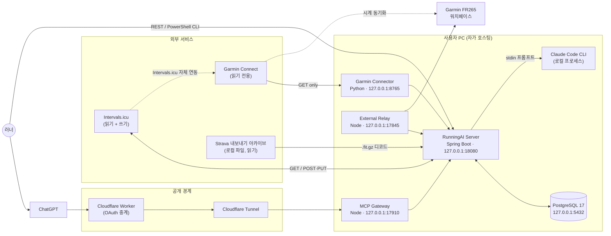

# 01. RunningAI 제품 개요와 핵심 가치

> 대상 독자: 🏃 일반 러너 · 🧰 처음 설치하는 사용자 · 💻 백엔드 개발자 · 🛠 시스템 운영자

### 쉽게 말하면

RunningAI는 **"내 달리기 데이터를 모아서, AI 코치가 오늘 할 운동을 설계하고, 내가 승인하면
시계까지 보내주는" 개인 전용 러닝 코치 시스템**이다.

하루의 흐름은 이렇다.

1. 밤새 Garmin 시계가 잰 심박·수면·HRV와 어제 뛴 기록이 자동으로 내 PC의 데이터베이스에 들어온다.
2. 아침에 AI 코치가 그 데이터를 보고 **오늘의 운동 초안**을 만든다 (예: "이지런 50분, 5:40/km").
3. 나는 그 초안을 보고 **승인하거나, 고쳐 달라고 하거나, 거절한다.** 내가 승인하기 전에는
   아무것도 밖으로 나가지 않는다.
4. 승인하면 Intervals.icu 캘린더에 올라가고, Intervals.icu가 Garmin Connect로 밀어준다.
   아침에 시계를 켜면 오늘의 운동이 구조화된 워크아웃으로 떠 있다.
5. 뛰고 나면 랩·구간·샘플까지 수집해서 "실제로 어떻게 뛰었는지"를 측정한다.

가장 중요한 특징은 **AI가 혼자 결정해서 실행하지 않는다**는 것이다. 사람의 승인이 모든
외부 쓰기 앞에 반드시 있다.

### 기술적으로는

RunningAI는 **단일 사용자(single-athlete) 자가 호스팅 개인 훈련 플랫폼**이다. Spring Boot 3.5
백엔드가 "진실의 저장소(system of record)"이고, 외부 시스템은 모두 **역할이 분리된 소스**로만
취급된다.

```
Garmin Connect   = 센서 진실 (심박/샘플/랩/회복)
RunningAI 분석   = 자체 파생 지표 (판단 없음, 측정만)
Intervals.icu    = 훈련부하/피트니스 모델 (CTL/ATL) + 워크아웃 캘린더 (쓰기 대상)
Strava 아카이브  = API로 도달 불가능한 과거 데이터의 유일한 복구 경로
Claude CLI       = 코칭 판단 (초안만, 실행 권한 없음)
ChatGPT (MCP)    = 대화형 조작 표면 (OAuth 스코프로 권한 분리)
```

---

## 1. 핵심 가치 5가지

### V1. 사람의 승인이 모든 외부 쓰기 앞에 있다 ✅ `SHIPPED`

AI 코치는 **초안(draft)만** 만든다. 외부 시스템(Intervals.icu)에 쓰기가 일어나려면 반드시
다음 네 가지가 모두 통과해야 한다.

1. 명시적 승인 — `POST /api/v1/workout-drafts/{id}/approve`
2. 게시 마스터 스위치 — `RUNNING_AI_DRAFT_PUBLISHING_ENABLED=true`
3. 부상 안전 게이트 — 최신 자가보고가 `RESOLVED`이고 48시간 이내
4. 게시 호출 — `POST /api/v1/workout-drafts/{id}/publish`

ChatGPT를 통해 조작할 때는 여기에 **두 단계가 더** 붙는다: `confirmedByAthlete: true`와
**직전 읽기에서만 얻을 수 있는 값의 echo**(`acknowledgedApprovalId`). 즉 "읽지 않고 승인"이
구조적으로 불가능하다.

> 💡 왜 중요한가: LLM이 캘린더에 직접 쓰는 시스템은 환각 한 번이 실제 훈련 일정 파괴로 이어진다.
> RunningAI는 그 경로 자체를 만들지 않았다.

### V2. 측정과 판단을 코드 수준에서 분리한다 ✅ `SHIPPED`

`analysis` 패키지(러닝 분석 엔진)에는 **점수·등급·좋음/나쁨 라벨을 넣을 수 없다.** 이것은
관례가 아니라 **빌드를 깨뜨리는 테스트**로 강제된다 — `GET /api/v1/training-analysis-report`
응답에 rating/score/verdict 계열 단어가 들어가면 테스트가 실패한다.

- 분석 엔진: "LTHR 이상 구간에 14분 23초 노출" ← 사실
- AI 코치: "어제 역치 노출이 길었으니 오늘은 회복" ← 판단

`analysis_status`(COMPLETE/PARTIAL/INSUFFICIENT_DATA)조차 **세션이 아니라 데이터의 상태**를
가리킨다.

### V3. 실패와 부재를 구분한다 ✅ `SHIPPED` (Phase 8A)

"데이터가 없다"는 세 가지 서로 다른 상황이다.

| 상황 | 예전 DB 표현 | 현재 |
| --- | --- | --- |
| 원본에 새 데이터가 없었다 | 행 없음 | `CONFIRMED_NO_DATA` |
| 아직 아무것도 실행하지 않았다 | 행 없음 | `NOT_COLLECTED` |
| 수집이 실패했다 | 행 없음 | `COLLECTION_FAILED` |

`garmin_sync_attempt`(V27)와 `garmin_recovery_collection`(V28)은 **순수 관측 테이블**이다.
어떤 코드도 "무엇을 가져올지" 결정하는 데 이 테이블을 읽지 않는다.

### V4. 신용할 수 없는 상태를 신용하지 않는다 ✅ `SHIPPED`

- 게시 POST의 **응답이 유실되면 재시도하지 않는다.** 대신 목록을 다시 읽어 실제 상태를
  확인한다(`IntervalsWorkoutPublisher`의 "re-list, never re-POST").
- `remote_state_certain`과 `external_write_attempted`는 **별개 컬럼**이다. 타임아웃은
  "썼는지 모른다"이지 "실패"가 아니다.
- Garmin 측 도달 확인에서 `deviceDelivery`는 **영구히 `UNKNOWN`** 이다 — 시계에 실제로
  떴는지는 어떤 API로도 증명할 수 없으므로 추측하지 않는다.

### V5. 되돌릴 수 있는 운영 ✅ `SHIPPED`

모든 위험 기능은 **독립된 환경변수 스위치**를 갖고 기본값이 `false`다. 스위치를 끄면
**직전 동작으로 바이트 단위 동일하게** 복귀한다. 레거시 게시와 AI 게시는 XOR로 강제되어
(`PublishingModeGuard`) 둘 다 켜면 **애플리케이션이 기동을 거부**한다.

---

## 2. 무엇이 아닌가 (의도적 비목표)

| 비목표 | 사유 |
| --- | --- |
| **Garmin에 직접 쓰지 않는다** ⛔ `ABSENT` | Spring·커넥터 모두 Garmin에 GET만 존재. 커넥터 테스트가 AST를 파싱해 `schedule_workout`/`upload_*_workout`/`push_workout_to_device`가 등장하면 **빌드를 실패**시킨다. Intervals→Garmin 푸시는 Intervals.icu 자체 연동 |
| **Strava API를 호출하지 않는다** ⛔ `ABSENT` | Strava 데이터는 사용자가 내려받은 **로컬 아카이브 디렉터리**에서만 읽는다. HTTP 클라이언트 없음, 스크래핑 없음 |
| **진단하지 않는다** ⛔ `ABSENT` | `injury_report`는 **자가보고 원장**이다. `RESOLVED`는 "본인이 그렇게 보고했다"는 데이터 허가이지 **의학적 완치 판정이 아니다** — 프롬프트가 코치에게 이 문장을 명시적으로 알린다 |
| **자동 재시도·알림 없음** ⛔ `ABSENT` | 게시 경로에 재시도가 없는 것은 버그가 아니라 설계다(V4) |
| **클라우드 SaaS가 아니다** | 데이터는 사용자 PC의 PostgreSQL에만 있다. 외부 노출은 Cloudflare 터널 한 홉뿐이고 그 뒤에 OAuth 게이트웨이가 있다 |

---

## 3. 시스템 컨텍스트



---

## 4. 현재 운영 실측 (2026-10-15~16 감사 기준)

> 이 수치는 저장소의 감사 보고서와 작업 기록에서 가져온 **실측치**이며, 제품의 규모감을
> 보여주기 위한 것이다. 시간이 지나면 변한다.

| 항목 | 실측 |
| --- | --- |
| 저장된 활동 | **48건** (GARMIN 8 · INTERVALS_ICU 25 · STRAVA 15) |
| 데이터 범위 | **2026-06-02 ~ 2026-10-11** (약 4.5개월) |
| 러닝 분석 결과 | **48/48** (활동과 1:1) |
| 활동 샘플 행 | **75,206행** |
| Intervals 피트니스 일별 | **99행** |
| 워크아웃 초안 | 19건 (DRAFT 10 / APPROVED 3 / SUPERSEDED 6) |
| 실제 Intervals 게시 성공 | **4건** (UPDATED 3 + Phase 10 수정 적용 1) |
| Flyway 마이그레이션 | **V31** |
| 서버 테스트 | 1442 PASS / 실패 0 / skip 0 (2026-10-15 감사 시점, Phase 10 이전) |

> ⚠️ **"1년치 데이터"는 현재 어떤 경로로도 존재하지 않는다.** Garmin Connect는 2026-09-18
> 이전이 없고, Intervals는 2026-08-02부터, Strava 아카이브가 2026-06-02까지가 최대치다.
> 그 이전은 API로도 아카이브로도 도달 불가능하다. (감사 보고서 §P3)
