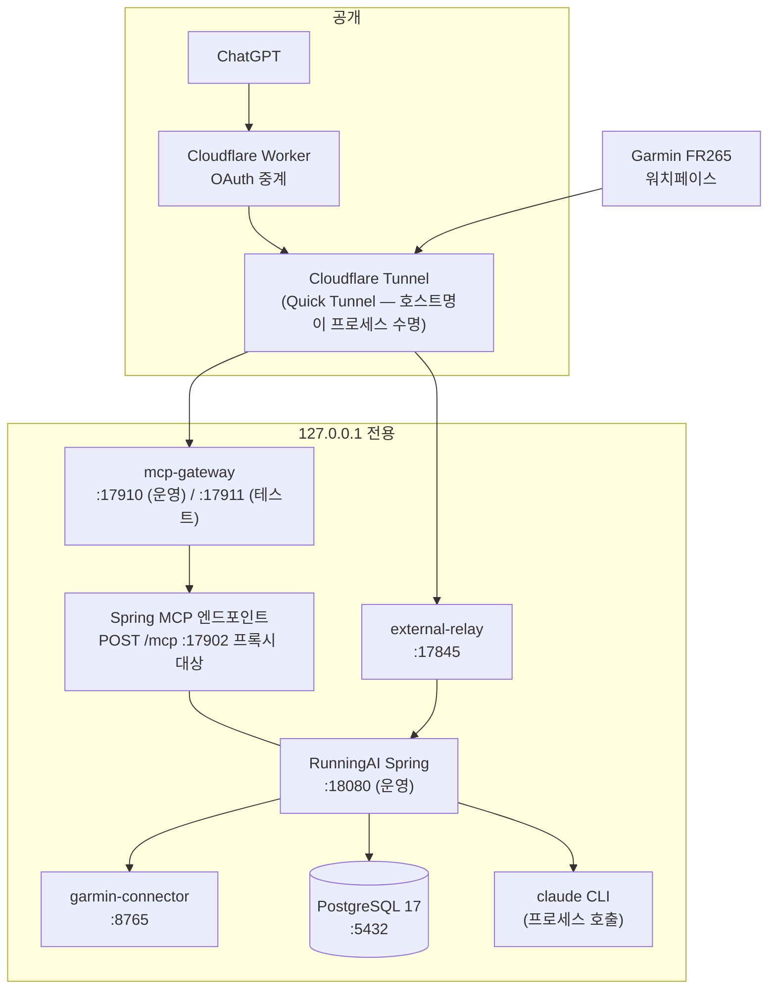

# 03. 전체 시스템 아키텍처와 기술 스택

> 대상 독자: 💻 백엔드 개발자 · 🛠 시스템 운영자

### 쉽게 말하면

RunningAI는 **클라우드 서비스가 아니라 내 PC에서 도는 프로그램 묶음**이다. 크게 6개의
프로세스가 각자 하나씩만 맡는다.

| 프로세스 | 하는 일 | 비유 |
| --- | --- | --- |
| PostgreSQL | 모든 데이터를 보관 | 창고 |
| Garmin Connector (Python) | Garmin에서만 데이터를 받아옴 | 통관 담당 |
| RunningAI Server (Spring) | 판단 빼고 전부 | 본사 |
| Claude CLI | 오늘 운동을 설계 | 코치 |
| MCP Gateway (Node) | ChatGPT가 들어오는 유일한 문 | 경비실 |
| External Relay (Node) | 시계에 오늘 운동을 알려줌 | 안내판 |

**모든 프로세스는 127.0.0.1(자기 자신)에만 열려 있다.** 외부에서 들어오는 길은 Cloudflare
터널 한 개뿐이고, 그 끝에도 OAuth 검사를 하는 경비실이 있다.

---

## 1. 기술 스택

### 1.1 백엔드 (`server/`)

| 항목 | 버전 / 선택 | 선택 이유 |
| --- | --- | --- |
| 런타임 | **Java 21** (toolchain 고정) | — |
| 프레임워크 | **Spring Boot 3.5.16** | — |
| 보조 언어 | **Kotlin 2.1.21** (plugin: jvm / spring / jpa) | Phase 6E 이후 **새 AI 코치 계열 코드만** Kotlin. 기존 Java는 그대로 둔다 |
| Kotlin 컴파일러 | `-Xjsr305=strict`, jvmTarget 21 | Java `@Nullable`/`@NonNull`을 **진짜 nullable**로 취급 → 상호운용 경계를 컴파일러가 검사 |
| MCP 서버 | **Spring AI 1.1.8** (`spring-ai-starter-mcp-server-webmvc`) | 1.1.x가 Boot 3.5용 라인. **Boot 4를 요구하는 2.x는 금지** |
| 영속 | Spring Data JPA / Hibernate 6, `ddl-auto: validate` | 스키마 소유자는 Flyway |
| 마이그레이션 | **Flyway (V1 ~ V31)** | 적용된 마이그레이션은 **절대 수정하지 않는다** |
| DB | **PostgreSQL 17** (Docker), 테스트는 **H2** | 로드베어링 제약은 H2에서도 **같은 메커니즘**으로 강제되어야 한다 (→ §3.3) |
| FIT 디코딩 | **`com.garmin:fit:21.176.0`** (공식 SDK, **디코드 전용**) | FIT은 프로파일 기반 바이너리라 임기응변 파싱으로는 못 읽는다 |
| 직렬화 | Jackson (+ `jackson-module-kotlin`), `default-property-inclusion: non_null` | |
| 테스트 | JUnit 5 + Spring Test | 2026-10-15 감사 시점 **1442 PASS / 실패 0 / skip 0 / 147 클래스 / 3m32s** |

**의존성 정책**: Lombok 금지. 투기적 추상화·불필요한 인터페이스 금지. 새 의존성은 **명확히
서술된 필요**가 있을 때만.

### 1.2 주변 도구 (`tools/`)

| 디렉터리 | 런타임 | 역할 | 테스트 |
| --- | --- | --- | --- |
| `garmin-connector` | Python (FastAPI 계열 ASGI) | Garmin 자격증명의 **유일한** 보유자. **GET 라우트만** | AST 검사 포함 |
| `mcp-gateway` | Node (`jose`) | OAuth 검증 + 스코프 집행 + MCP 프록시 | 46/46 |
| `mcp-worker` | Cloudflare Worker | OAuth 중계 (ChatGPT ↔ Auth0 ↔ 터널) | 34 + 49 |
| `external-relay` | Node | 워치페이스용 읽기 전용 서비스 | 14/14 |
| `mcp-poc` | Node | 초기 실험 (운영 아님) | — |

### 1.3 런타임 아티팩트

| 플랫폼 | 위치 | 구성 |
| --- | --- | --- |
| Windows (운영) | `scripts/windows/` | 시작·정지·상태·워치독·예약작업 등록 PowerShell |
| Linux | `deploy/linux/` | systemd 유닛 2종(`running-ai.service`, `running-ai-garmin-connector.service`), 설치/배포/검증 셸 |
| DB | `docker-compose.yml` | `postgres:17`, **`127.0.0.1:5432`로만 publish** |

---

## 2. 프로세스 토폴로지와 포트



> 🔐 **하드코딩된 보장**: `mcp-gateway`는 `const HOST = '127.0.0.1'`로 **설정 불가능하게**
> 루프백에만 바인드한다. 프록시 대상도 기동 시점에 **고정된 단일 로컬 URL**이라, 범용 REST
> 프록시로 전용될 수 없다. `external-relay` 역시 `const HOST = '127.0.0.1'`.

---

## 3. 아키텍처 원칙 (불변식)

### 3.1 계층

```
Controller  →  Service  →  Entity  →  Repository
```

- **엔티티를 API DTO로 노출하지 않는다.** DTO는 Java record.
- **컨트롤러에 비즈니스 로직 없음.**
- **외부 시스템 코드는 도메인/응용 로직 밖에 있다.**

### 3.2 패키지 지도

| 패키지 | 언어 | 책임 |
| --- | --- | --- |
| `common` | Java | 설정, 예외(`GlobalExceptionHandler`), 헬스 |
| `athlete` | Java | Athlete, 강도 프로필(LTHR·임계 페이스) |
| `activity` | Java | Activity, ActivityRaw, 활동 HTTP API, `MetricAvailability` |
| `activity.detail` | Kotlin | 상세(랩·존·샘플) 저장소 |
| `training` | Java | 훈련부하, 추천/처방/강도 타깃, `StructuredWorkout` |
| `analysis` | Kotlin | 러닝 분석 엔진 — **판단 금지 구역** |
| `coach` (+ `coach.claude`) | Kotlin | TrainingContext V1/V2, 초안, 승인, Claude 어댑터 |
| `injury` | Kotlin | 자가보고 원장, `WorkoutSafetyPolicy`, 게이트 |
| `recovery` | Java | 회복 베이스라인 |
| `draftpublish` | Kotlin | 승인 초안 게시 게이트웨이, `PublishingModeGuard`, `today-workout` |
| `revision` | Kotlin | 게시 후 수정 (Phase 10) |
| `delivery` | Kotlin | 게시물이 Garmin에 도달했는가 |
| `enrichment` | Kotlin | 활동 ↔ 외부 소스 링크 |
| `backfill` | Kotlin | 90일 과거 백필 |
| `datafreshness` | Kotlin | 소스 신선도 통합 보고 |
| `coachrefresh` | Kotlin | 코치 데이터 갱신 |
| `integration.garmin` | Java+Kotlin | 커넥터 클라이언트, 증분 동기화, 서킷 브레이커, 스케줄러 |
| `integration.intervals` | Java+Kotlin | 렌더러, 게시자, 읽기 클라이언트, 임포터 |
| `integration.strava` | Kotlin | 아카이브 임포터 |
| `integration.mcp` (+ `.read` / `.train`) | Java+Kotlin | MCP 도구 어댑터 |

### 3.3 아키텍처가 테스트로 강제된다

관례가 아니라 **빌드 실패**로 지켜지는 규칙들:

| 테스트 | 금지하는 것 |
| --- | --- |
| `CoachArchitectureTest` | `coach` → `draftpublish` 임포트 (그래서 `today-workout`이 `draftpublish`에 있다) |
| `DraftPublishArchitectureTest` | `draftpublish` → `integration.garmin` 임포트 (그래서 `delivery` 패키지가 존재한다) |
| `TrainMcpToolsArchitectureTest` | MCP 어댑터 → 렌더러/게시자/리포지토리/코치 직통 경로 |
| 분석 리포트 어휘 테스트 | 응답에 rating/score/verdict 계열 단어 |
| 커넥터 AST 테스트 | `schedule_workout` / `upload_*_workout` / `push_workout_to_device` 등장, 그리고 GET 아닌 라우트 |
| `GarminSchedulerSwitchBindingTest` | `application.yml`의 스케줄러 스위치가 리터럴로 되돌아가는 것 |

> 💡 **설계 통찰**: "패키지 경계를 지키자"는 합의는 깨진다. 이 저장소는 **깨지면 빌드가
> 멈추게** 만들었고, 그 결과 `delivery`와 `TodayWorkoutController`의 위치 같은 비직관적
> 배치에는 전부 테스트가 적힌 사유가 있다.

### 3.4 시간과 식별자

- 시간은 **UTC `Instant` / `TIMESTAMPTZ`** 로 저장한다. 사용자에게 보이는 날짜 계산은
  **선수 타임존**(기본 `Asia/Seoul`)에서 수행한다.
- **내부 PK는 절대 외부 ID가 아니다.** 외부 신원은 `external_source + external_id`.
- 테스트는 H2, 운영은 PostgreSQL이므로 **로드베어링 제약은 두 엔진에서 같은 메커니즘으로
  강제되어야 한다.** 그래서 Phase 10의 "게시물당 열린 수정은 최대 1건"은 PostgreSQL 부분
  인덱스가 아니라 **nullable `open_slot` + 평범한 `UNIQUE` + `CHECK`** 로 구현됐다.

### 3.5 스위치 철학

모든 위험 기능은 **독립된 환경변수**를 갖고 기본값이 `false`이며, 끄면 **직전 동작으로 정확히
복귀**한다.

| 스위치 | 기본 | 제어 대상 |
| --- | --- | --- |
| `WORKOUT_PUBLISHING_ENABLED` | false | 레거시 결정론 게시 |
| `WORKOUT_PUBLISHING_SCHEDULER_ENABLED` | false | 그 스케줄러 (05:00 KST) |
| `RUNNING_AI_DRAFT_PUBLISHING_ENABLED` | false | AI 승인초안 게시 |
| `RUNNING_AI_PUBLISHED_REVISION_ENABLED` | false | 게시 후 수정의 **apply만** |
| `RUNNINGAI_MCP_ENABLED` | false | 레거시 `publish_workout` MCP 도구 |
| `RUNNINGAI_MCP_READ_ENABLED` | false | read 도구 7종 |
| `RUNNINGAI_MCP_TRAIN_ENABLED` | false | train/revision 도구 |
| `RUNNING_AI_GARMIN_SCHEDULER_ENABLED` | false | Garmin 증분 동기화 자동 실행 |
| `GARMIN_PROFILE_SYNC_ENABLED` | false | 프로필 동기화 (04:30 KST) |
| `RUNNING_AI_COACH_REFRESH_SCHEDULER_ENABLED` | false | 코치 데이터 갱신 |
| `RUNNING_AI_INTERVALS_ACTIVITY_IMPORT_ENABLED` | false | Intervals 활동 임포트 |
| `RUNNING_AI_STRAVA_ARCHIVE_IMPORT_ENABLED` | false | Strava 아카이브 임포트 |
| `RUNNING_AI_GARMIN_CIRCUIT_BREAKER_ENABLED` | **true** | 자동 동기화 차단기 (false면 8B 이전 동작) |

**상호 배제**: `WORKOUT_PUBLISHING_ENABLED`와 `RUNNING_AI_DRAFT_PUBLISHING_ENABLED`가 **둘 다
true면 애플리케이션이 기동하지 않는다** (`PublishingModeGuard`).

> ℹ️ **Phase 9 Stage 4 사례** — `application.yml`에서 Garmin 스케줄러 스위치만 플레이스홀더
> 없는 리터럴 `false`였다. OS 환경변수는 Spring의 완화된 이름 매핑으로 **여전히 이겼으므로
> 고장난 것은 아니었지만**, 테스트·커맨드라인·`application-local.yml` 같은 다른 소스로는
> 설정할 수 없었다. Route A는 이를 `${RUNNING_AI_GARMIN_SCHEDULER_ENABLED:false}`로 바꾸고
> 회귀를 **테스트로 봉인**했다. (코드 변경 완료, **운영 활성화는 아직 아님**)

---

## 4. 컴포넌트 아키텍처 다이어그램

`diagrams/02-component-architecture.mmd` 참조.

---

## 5. 배포 형상

| 환경 | 구성 |
| --- | --- |
| 운영 (Windows 메인 PC) | `.runtime/running-ai-server.jar` + Docker Postgres + 커넥터 venv + Node 도구 2종 + 예약작업 2종 |
| 개발 | 동일 저장소, 별도 포트·별도 DB (worktree 병행 개발) |
| Linux | systemd 2유닛, `deploy/linux/scripts/*.sh` |
| CI/테스트 | H2 인메모리, 외부 호출 0 |

> ⚠️ **릴리스 함정 (운영 기록)**: jar 교체는 **Spring을 멈춘 상태에서만** 한다. 게이트웨이
> 재시작은 `GATEWAY_STARTED`가 명시적으로 말하지 않으면 **조용히 옛 코드를 유지**한다.
