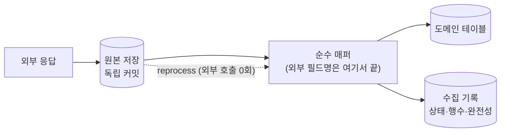
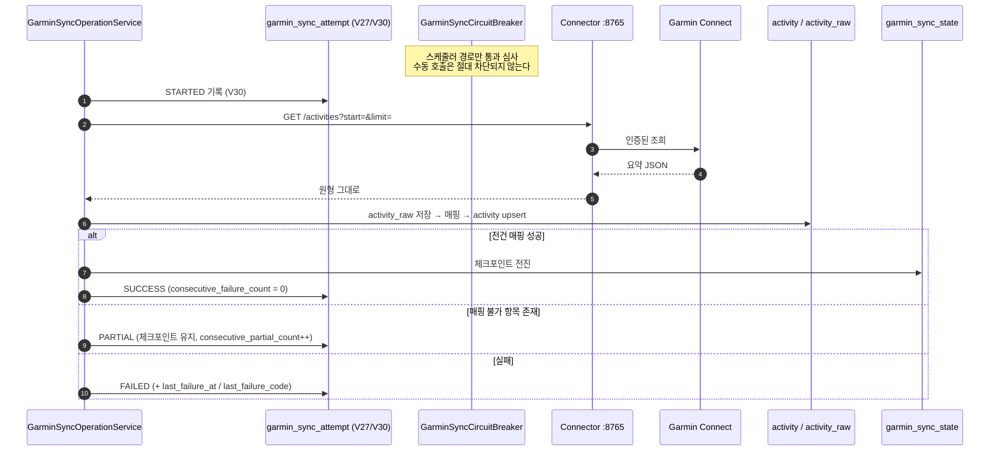
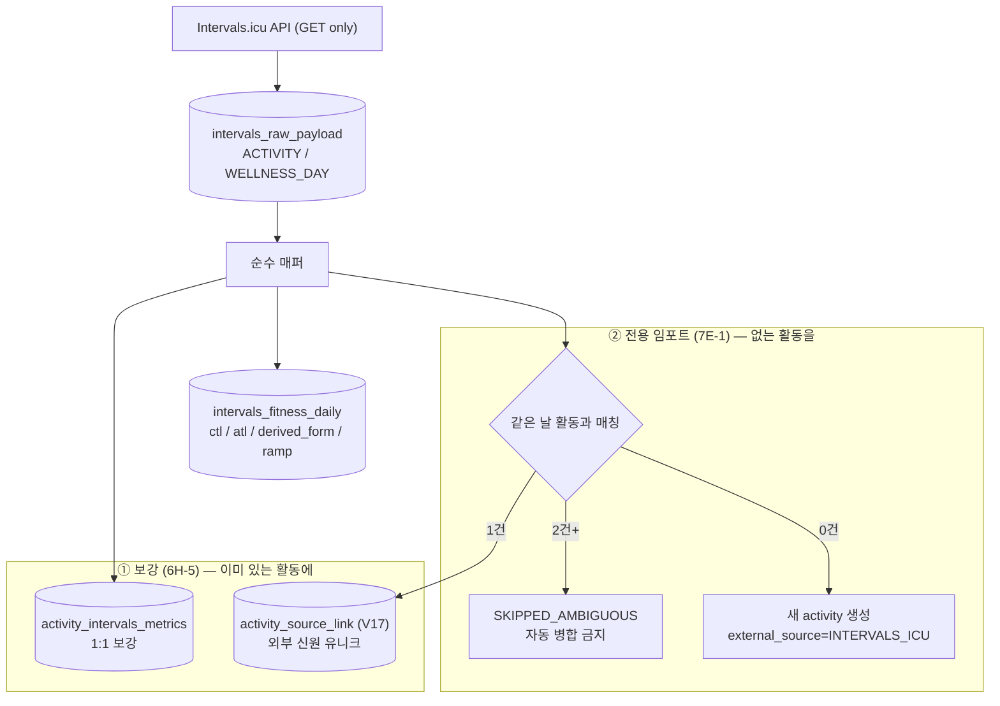
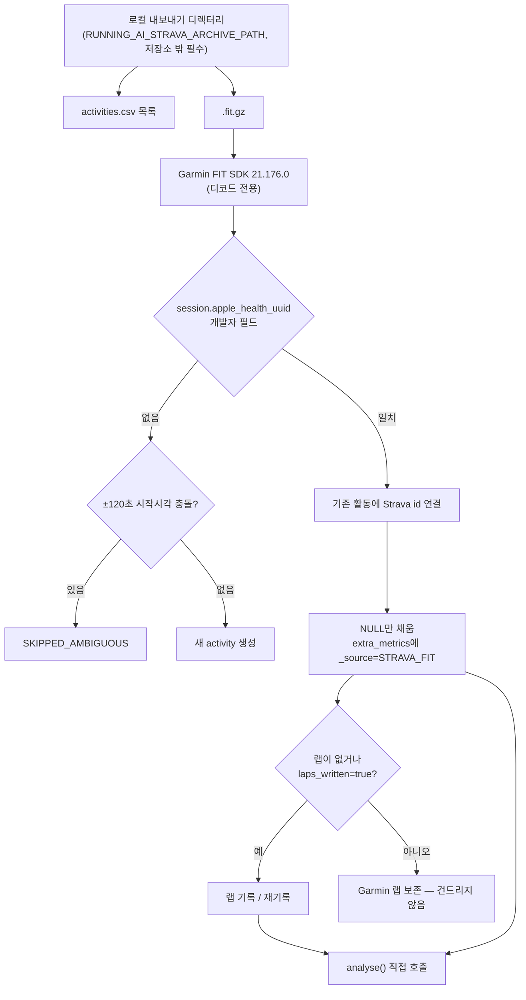

# 05. Garmin · Intervals.icu · Strava 데이터 수집 흐름

> 대상 독자: 💻 백엔드 개발자. 기능 요약은 [02장 A절](02-feature-specification.md) 참조.

### 쉽게 말하면

세 개의 소스는 **경쟁자가 아니라 역할이 다른 동료**다.

| 소스 | 이 시스템에서의 역할 | 비유 |
| --- | --- | --- |
| **Garmin Connect** | 센서 진실 — 심박·샘플·랩·수면·HRV | 측정 장비 |
| **Intervals.icu** | 훈련부하 모델(CTL/ATL) + **워크아웃 캘린더** | 트레이닝 로그 + 일정표 |
| **Strava 아카이브** | API로 못 가는 과거의 **유일한** 복구 경로 | 창고에서 찾은 오래된 수첩 |

같은 운동이 세 곳에 있어도 **활동 행은 하나**다. 두 번째 소스는 "새 활동"이 아니라
**기존 활동에 붙는 링크**가 된다.

---

## 1. 공통 원칙: Raw-First



| 원칙 | 이유 |
| --- | --- |
| 원본을 **먼저, 독립 트랜잭션으로** 저장 | 매퍼 버그가 데이터 손실이 되지 않는다 |
| 외부 필드명은 **매퍼에서 끝난다** | 도메인이 외부 API 어휘에 오염되지 않는다 |
| 미지 키는 `extra_metrics`에 보존 | 나중에 의미를 알게 되어도 재수집이 필요 없다 |
| `reprocess` 엔드포인트는 **외부 호출 0회** | 매퍼 수정이 과거 데이터에 도달한다 |

원본 테이블: `activity_raw`(요약), `activity_raw_payload`(V11, 활동+타입별),
`intervals_raw_payload`(V18, ACTIVITY / WELLNESS_DAY)

---

## 2. Garmin 수집 흐름



### 2.1 왜 시도 원장이 `garmin_sync_state`의 컬럼이 아닌가

`garmin_sync_state`의 타임스탬프는 **NOT NULL**이다. 그래서 **한 번도 성공한 적 없는 선수의
실패를 담을 수 없다.** 별도 테이블이어야 하는 구조적 이유이며, 동시에 백필의
"`garmin_sync_state`를 절대 건드리지 않는다" 불변식이 유지된다.

### 2.2 서킷 브레이커 (Phase 8B-A) ✅ `SHIPPED`

**`GarminSyncScheduler`만** 통제하고 **다른 어떤 것도 통제하지 않는다.** 수동
`POST /api/v1/garmin/sync`는 절대 차단되지 않는다 — **그 요청이 바로 기다리던 개입**이고,
완료된 시도가 인증 차단을 푸는 것이기 때문이다. 그래서 **손으로 리셋할 플래그가 없고**,
브레이커가 성공했을 동기화를 막는 일도 생길 수 없다.

| 실패 클래스 (`GarminFailureClass`) | 정책 |
| --- | --- |
| `AUTH` (401/403) | **3회**면 자동 동기화 정지, **만료 없음** |
| `RATE_LIMIT` | **첫 발생**에 백오프 |
| `TRANSIENT` | **8회**까지 허용 |
| 공통 | `minimum-interval` **15분** = 자동 요청 빈도의 하드 플로어 |

`GarminActivityRegistry`는 **권고용**이다 — 틀려도 비용은 틱 하나 건너뛰기.

### 2.3 상세 수집 (수동 전용)

```
POST /api/v1/garmin/activities/{garminActivityId}/details
POST /api/v1/garmin/activities/{garminActivityId}/details/reprocess   (Garmin 호출 0회)
```

파트별 상태는 `activity_detail_collection`(V13/V14): COMPLETE / PARTIAL / FAILED,
그리고 `requested_max_chart_size` · `source_metrics_count` · `source_total_metrics_count` ·
`sample_completeness`. **계정 수준 실패는 실행 전체를 중단**시킨다.

> 📌 `activity_detail`은 **이미 `activity_raw`에 있는 목록 항목**에서 온다.
> `get_activity`는 raw 전용이다.

### 2.4 회복 수집

```
POST /api/v1/garmin/recovery-sync              (단일 날짜)
POST /api/v1/garmin/recovery-sync/backfill     (≤28일, 순차, 재시도 없음, 첫 실패에서 중단)
GET  /api/v1/garmin/recovery-sync/coverage     (판정, ≤365일)
```

`GarminRecoveryMetricGroup`이 **"이 지표가 무언가를 내놓았는가"의 단일 정의**이며, 매퍼와
커버리지 리포트가 같은 정의를 쓴다. 기록 테이블의 컬럼은 `*_outcome`이지 `*_status`가 아니다 —
`garmin_recovery_daily.hrv_status`는 **Garmin 자신의 라벨**이기 때문에 이름이 충돌하면 안 된다.

---

## 3. Intervals.icu 수집 흐름

### 3.1 두 갈래



### 3.2 매칭 우선순위 (실측 근거)

| 순위 | 방법 | 조건 |
| --- | --- | --- |
| 1 | `SOURCE_ID` | `source=GARMIN_CONNECT` + `external_id` = Garmin id — **실측 5/5 적중** |
| 2 | `EXTERNAL_ID` | 외부 신원 직접 일치 |
| 3 | `COMPOSITE` | **실제로 관측된 타입 쌍만**. \|start\|≤30s, \|duration\|≤5s, \|distance\|≤5m |

- 다른 Garmin id를 **명시적으로 주장하는** 후보는 절대 매치되지 않는다.
- 0건 → `UNMATCHED`는 정상. 2건 이상 → `AMBIGUOUS`, 자동 링크 금지.
- 이미 다른 곳에 링크됨 → **409 `INTERVALS_LINK_CONFLICT`**

### 3.3 엔드포인트

```
POST /api/v1/intervals/enrichment/activities/{activityId}            (+ /reprocess)
POST /api/v1/intervals/enrichment/fitness?oldest=&newest=            (범위 ≤31일) (+ /reprocess)
GET  /api/v1/activities/{activityId}/intervals
GET  /api/v1/intervals/fitness
POST /api/v1/intervals/activity-import                               (전용 임포트)
GET  /api/v1/intervals/activity-import
POST /api/v1/intervals/activity-import/{intervalsActivityId}/reprocess  (API 호출 0회)
```

**스케줄러·웹훅·주기 동기화 없음.** 전부 수동 트리거다.

### 3.4 경계 규칙

- Intervals 값은 **`activity_analysis`에 절대 들어가지 않는다.**
- Intervals wellness는 **`garmin_recovery_daily`를 절대 덮어쓰지 않는다.**
- `activity_sample`은 **Garmin 전용**이다 (7E-1 임포트는 예외적으로 자체 스트림을 쓰되 출처를
  명시하고 완전성을 UNKNOWN으로 둔다).

---

## 4. Strava 아카이브 수집 흐름



### 4.1 왜 이 경로가 필요한가

| 시도 | 결과 |
| --- | --- |
| Intervals API로 Strava 활동 읽기 | **전건 `422 Cannot read Strava activities via the API`** |
| Garmin Connect | 2026-09-18 **이전이 없음** |
| 90일 백필 | Garmin 탐색 기반 → **구조적으로 도달 불가** |

→ 남은 유일한 경로가 **사용자가 직접 내려받은 로컬 아카이브**다.

### 4.2 조인이 정확한 이유

Strava는 Apple Health 워크아웃을 FIT으로 재인코딩하며 세션 메시지에 개발자 필드
`apple_health_uuid`를 남긴다. 이 값이 Intervals.icu의 `external_id`와 **문자 단위로 일치**한다.

- 실측 **27/27 일치, 모순 0**
- 부수 성과: `i180579462` = Strava `19929243277` 확인 — Intervals가 **두 번** 들고 있던
  Stair-Stepper의 정체가 밝혀졌다

### 4.3 V26 `strava_activity_import` 한 테이블의 5역할

(athlete, Strava activity)당 1행이며 파일의 SHA-256을 보유한다. 이 한 행이 동시에:
**멱등 키 · 재개 지점 · 진행 로그 · 품질 기록 · 교차 시스템 출처(provenance)** 다.
**재-POST가 곧 재개이자 재시도**이며, 자동 재시도는 어디에도 없다. 읽을 수 없는 파일 하나가
나머지를 멈추지 않는다.

**복사 DB 검증 결과**: 15건 임포트, 33건 보강(랩 116, 샘플 18,541), 46건 미지원 기록,
ambiguous 0, 실패 0, 재실행 Δ=0 (17개 테이블), kill-and-resume 무손실.

---

## 5. 데이터 신선도와 커버리지 ([02장 A8](02-feature-specification.md))

```
GET /api/v1/data-freshness        소스별 최신 데이터 날짜·지연·건수·마지막 시도/성공/실패
GET /api/v1/garmin/recovery-sync/coverage
```

`collectionTracked = false`인 소스(수동 임포터)는 시도 원장이 없다. 그 사실을 명시하기 때문에
**오래된 데이터가 "새 게 없다"로 오독되지 않는다.**

---

## 6. 전체 수집 흐름도

`diagrams/03-data-collection.mmd` 참조.

---

## 7. 수집의 알려진 한계 (정직한 목록)

| 한계 | 상태 | 비고 |
| --- | --- | --- |
| 보유 데이터 ≈ 4.5개월 (2026-06-02 ~) | 사실 | "1년치"는 어떤 경로로도 존재하지 않는다 |
| 회복 데이터 21행 < 28일 창 | 🟢 수집은 동작, 베이스라인 운영 미실증 | P3-2 |
| 90일 백필 운영 실행 이력 없음 | 🟢 `BUILT` | 복사 DB 검증까지 |
| 임포트 활동 케이던스 | ⏸️ 의도적 부재 | rpm↔spm 미변환 |
| Strava 랩의 인터벌 그룹 | ⛔ 원리적 불가 | 재인코딩에 메타데이터 없음 |
| Garmin 자동 동기화 | ⏸️ `OFF` | Phase 9 Stage 4가 이 활성화 단계 |
