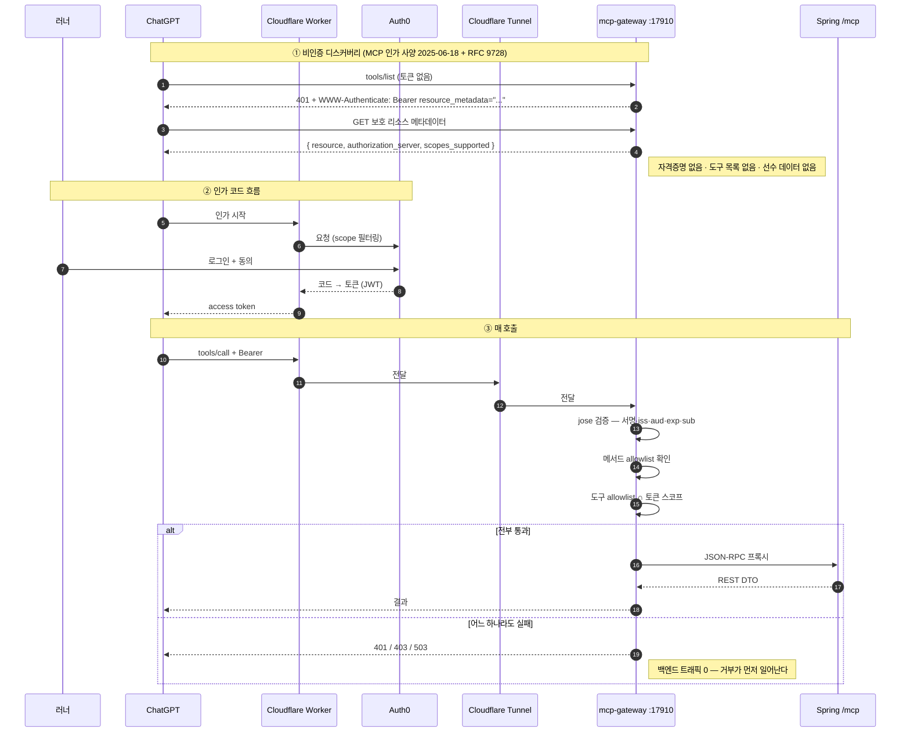

# 06. ChatGPT MCP · OAuth · Gateway 연동 구조

> 대상 독자: 💻 백엔드 개발자 · 🛠 시스템 운영자
> 설계 문서: `docs/architecture/chatgpt-training-mcp.md`

### 쉽게 말하면

ChatGPT에게 "오늘 뭐 뛰면 돼?" 라고 물으면, ChatGPT가 내 PC의 RunningAI에 연결해서 진짜 내
데이터를 읽는다. 여기서 중요한 건 **권한이 세 단계로 쪼개져 있다**는 것이다.

| 권한 | 할 수 있는 일 | 비유 |
| --- | --- | --- |
| `runningai:read` | 내 데이터를 **읽기만** | 열람실 출입증 |
| `runningai:train` | 운동 **설계·승인** (아직 밖으로 안 나감) | 초안 작성 권한 |
| `runningai:publish` | 실제 **캘린더에 쓰기** | 도장 |

**이 세 권한은 계층이 아니다.** `train`을 가졌다고 `publish`가 되지 않는다. 각각 따로 주고
따로 뺏는다.

---

## 1. 세 개의 독립 스위치 (Spring 쪽)

Spring에는 MCP 도구 그룹을 켜는 스위치가 **셋**이고, 서로 독립이다.

| 환경변수 | 속성 | 켜는 것 | 기본 |
| --- | --- | --- | --- |
| `RUNNINGAI_MCP_ENABLED` | `running-ai.mcp.enabled` | 레거시 `publish_workout` 1종 | false |
| `RUNNINGAI_MCP_READ_ENABLED` | `running-ai.mcp.read-enabled` | read 7종 | false |
| `RUNNINGAI_MCP_TRAIN_ENABLED` | `running-ai.mcp.train-enabled` | train 5 + publish 1 + revision 6 | false |

셋 중 **하나라도** 켜지면 Spring AI MCP 서버가 켜진다. 전부 꺼지면 서버 자체가 꺼진다
(Spring AI의 자체 기본값은 on이므로 `McpServerSwitchEnvironmentPostProcessor`가 이를 뒤집는다).

> ⚠️ `POST /mcp`에는 **인증이 없다.** 절대 공개 노출하지 않는다. 공개 레그는 게이트웨이가 담당한다.

---

## 2. MCP 도구 카탈로그 (코드 정의 20종)

### 2.1 read (7) — `runningai:read` ✅ `SHIPPED` · 라이브 교차검증됨

```
get_recent_activities      get_activity_analysis    get_training_context
get_recovery_context       get_fitness_trend        get_workout_recommendation
get_athlete_profile
```

### 2.2 train (5) — `runningai:train` ✅ `SHIPPED`

```
create_workout_draft   get_workout_draft   revise_workout_draft
approve_workout_draft  preview_draft_publish
```

### 2.3 publish (1) — `runningai:publish` ✅ `SHIPPED`

```
publish_approved_draft
```

### 2.4 revision (6, Phase 10)

| 도구 | 스코프 |
| --- | --- |
| `create_workout_revision` | `runningai:train` |
| `get_workout_revision` | `runningai:train` |
| `approve_workout_revision` | `runningai:train` |
| `abandon_workout_revision` | `runningai:train` |
| `preview_revision_apply` | `runningai:train` |
| **`apply_workout_revision`** | **`runningai:publish`** |

> ✅ Phase 10 완료 시점에 `apply_workout_revision`이 게이트웨이에서 활성화되었고, 실제 수정
> #1이 event 145043355에 `UPDATED`로 적용되어 **FR265에서 확인**되었다.

### 2.5 레거시 (1) — 영구 차단

`publish_workout` — 게이트웨이가 **명시적으로 거부**한다. allowlist에 등재 불가.

### 2.6 어댑터 설계 원칙

모든 train/revision 도구는 **REST API가 이미 호출하는 서비스 위의 얇은 어댑터**이며
**REST DTO 자체를 반환**한다. 그래서 두 표면이 어긋날 수 없다.

**어떤 생명주기 규칙도 재구현하지 않는다** — 승인 불변성, 선수+날짜당 1승인, 부상 게이트,
게시 마스터 스위치, 초안별 단일 비행, "재게시는 저장된 결과를 반환"은 전부 서비스에 남아 있다.
`TrainMcpToolsArchitectureTest`가 어댑터에 렌더러·게시자·리포지토리·코치로 가는 경로가 생기면
**빌드를 실패**시킨다.

실패는 **REST와 동일한 코드**를 쓰고, 모든 응답과 로그 라인에 `correlationId`가 붙는다.

> 🚫 **코치는 절대 날조되지 않는다** — CLI가 없거나 타임아웃이거나 계약을 벗어나면
> `AI_COACH_<reason>`으로 **실패**한다. 대체 워크아웃을 만들어 주지 않는다.

---

## 3. "MCP 호출은 선수의 승인이 아니다" — 이중 확인

`approve_workout_draft`, `publish_approved_draft`, 그리고 Phase 10의 세 커밋 도구
(`approve_` / `abandon_` / `apply_workout_revision`)는 **추가로** 다음을 요구한다.

1. `confirmedByAthlete: true`
2. **직전 읽기에서만 얻을 수 있는 값의 echo** — `acknowledgedVersion` / `acknowledgedApprovalId`

두 조건은 **커밋 서비스에 진입하기 전에 읽기 전용으로** 검사된다. 즉 **읽지 않고 승인**하는
경로가 구조적으로 없다.

> 💡 `abandon`도 포함되는 이유: 선수가 이미 승인했을 수 있는 내용을 **폐기**하기 때문이다.

---

## 4. OAuth 체인



### 4.1 게이트웨이의 구조적 보장

| 보장 | 구현 |
| --- | --- |
| 루프백 전용 | `const HOST = '127.0.0.1'` — **설정 불가** |
| 범용 프록시 불가 | 대상 URL은 기동 시 **고정**, 경로/호스트 포워딩 없음 |
| 단일 주체 | `RUNNING_AI_ALLOWED_SUB` — 정확히 한 subject만 허용 |
| 메서드 제한 | `initialize` / `ping` / `tools/list` / `tools/call` / `notifications/*` **만** |
| 목록 필터링 | `tools/list` 응답을 (allowlist ∩ 허용 스코프)로 필터 — 심층 방어 |
| 비밀 비노출 | Authorization 헤더·토큰·요청 바디가 **로그 라인에 닿지 않는다** |
| 암호 자작 금지 | `jose`(panva) + `createRemoteJWKSet` |

### 4.2 deny-by-default 스코프 정책 (Phase 10 감사)

```js
const scopeFor = (tool) => {
  if (!Object.prototype.hasOwnProperty.call(TOOL_SCOPES, tool)) return undefined; // = DENY
  const scope = TOOL_SCOPES[tool];
  return scope === BASE_SCOPE ? REQUIRED_SCOPE : scope;
};
```

- **모든 서빙 가능 도구가 명시 항목을 갖는다.** 읽기 도구는 `BASE_SCOPE` 센티널로 등재되며
  여전히 `RUNNING_AI_REQUIRED_SCOPE`를 따른다.
- allowlist에 매핑 없는 도구가 있으면 **게이트웨이가 기동을 거부하고 그 이름을 밝힌다.**

> 🐛 **고쳐진 결함**: 예전 `TOOL_SCOPES[tool] || REQUIRED_SCOPE` 폴백은 매핑되지 않은 **쓰기
> 도구를 읽기 전용 토큰에게 조용히 제공**했다. 호출이 성공했기 때문에 **스스로를 알릴 수 없는
> 종류의 실패**였다.

---

## 5. 운영에서 겪은 함정 (운영자 필독)

| 함정 | 증상 | 대응 |
| --- | --- | --- |
| **ChatGPT가 도구 목록을 캐시한다** | 새 도구가 보이지 않음 | **재연결**해야 나타난다. 캐시인지 진짜 장애인지는 **게이트웨이 로그**가 구분해 준다 |
| **스코프 캐시가 재생된다** | train 권한을 열었는데 토큰이 여전히 read-only | **커넥터를 완전 삭제 후 재등록**해야 새 스코프를 재탐색한다. 재연결만으로는 캐시된 스코프가 그대로 재생된다 (7F-3B-3에서 입증된 유일한 방법) |
| **Quick Tunnel 호스트명 소멸** | 터널 재시작 후 502 | 호스트명은 **프로세스 수명**과 같다. Worker의 `ORIGIN_MCP_URL`을 재배포해야 한다. 워치독은 그래서 터널을 **절대 재시작하지 않는다** |
| **게이트웨이 재시작이 옛 코드를 유지** | 코드를 고쳤는데 동작이 그대로 | `GATEWAY_STARTED`가 명시적으로 말하지 않으면 **조용히 옛 프로세스가 산다** |
| **게이트웨이가 죽어 있음** | 터널 502 | Worker 재배포 전에 **게이트웨이 생사부터** 확인. Phase 9에서 워치독 감시 대상에 편입 |

---

## 6. 현재 노출 상태 (2026-10-16 기준)

| 항목 | 상태 |
| --- | --- |
| read 7종 | ✅ 라이브 — ChatGPT 실제 호출 교차검증 |
| train 5종 | ✅ 라이브 — 인증된 `runningai:train` 레그 PASS |
| `publish_approved_draft` | ✅ 게이트웨이 노출 |
| revision 6종 | ✅ 게이트웨이 노출 (**19종** 서빙) |
| `publish_workout` | 🚫 영구 차단 |
| 터널 | Quick Tunnel (호스트명 비고정) — Named Tunnel은 미결정 |

> 🔵 `DESIGN` — 다중 사용자 환경에서의 OAuth 분리는 [14장](14-multi-user-isolation.md)에서
> 다룬다. 현재 게이트웨이는 `RUNNING_AI_ALLOWED_SUB`로 **정확히 한 명**만 허용한다.
