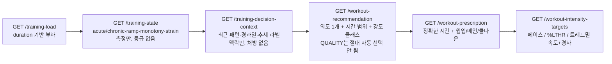
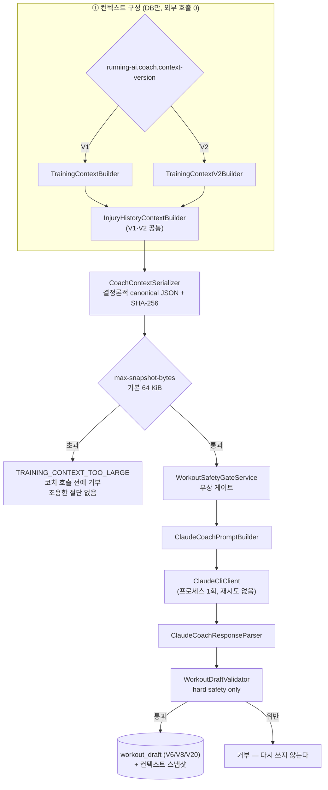

# 07. Claude CLI 기반 AI 코칭 및 훈련 추천 구조

> 대상 독자: 💻 백엔드 개발자 · 🏃 일반 러너
> 설계 문서: `docs/architecture/training-context-v2.md`, `docs/architecture/ai-draft-targets.md`

### 쉽게 말하면

RunningAI에는 **두 개의 서로 다른 "추천 엔진"** 이 있다. 헷갈리기 쉬우니 먼저 구분하자.

| | ① 결정론적 처방 (규칙 엔진) | ② AI 코치 (Claude) |
| --- | --- | --- |
| 무엇 | 고정된 규칙으로 계산 | 맥락을 읽고 판단 |
| 출력 | 운동 의도 + 시간 범위 + 강도 클래스 | 제목·구간·근거까지 있는 **초안** |
| 인터벌/반복 | ⛔ 불가 | ✅ 가능 |
| QUALITY 세션 | ⛔ **명시적으로 거부** | ✅ 가능 |
| 쓰임 | 참고값, 레거시 게시 경로 | **현재 주력 경로** |

AI 코치는 **Claude Code CLI를 로컬 프로세스로 한 번 실행**해서 쓴다. API 키를 쓰지 않고,
CLI 자신의 로그인 세션을 쓴다. 그리고 **코치에게는 아무 도구도 주지 않는다** — 파일도 못 읽고
인터넷도 못 보고 RunningAI의 MCP 도구도 못 쓴다. 코치가 할 수 있는 건 **텍스트를 반환하는 것뿐**이다.

---

## 1. 결정론적 처방 경로 (규칙 엔진) ✅ `SHIPPED`

읽기 전용 REST 체인. 각 단계는 앞 단계의 출력만 쓴다.



| 단계 | 하지 않는 것 |
| --- | --- |
| training-state | **평가(rating)를 하지 않는다** |
| decision-context | **처방하지 않는다** |
| recommendation | 워크아웃 **스텝을 만들지 않는다**. QUALITY를 **자동 선택하지 않는다** |
| prescription | 정성적 강도만. **QUALITY 미지원** (`QUALITY_PRESCRIPTION_NOT_SUPPORTED`) |
| intensity-targets | 프로필이 없거나 불완전하면 **QUALITATIVE 폴백**. CROSS_TRAINING은 러닝 임계 프로필을 **절대 쓰지 않는다** |

**타깃 우선순위**: 둘 다 가능하면 **페이스가 심박보다 우선**. 타깃은 매 호출 파생되며
**절대 영속화되지 않는다.**

**강도 프로필** — `GET` / `PUT /api/v1/athlete/intensity-profile` (LTHR + 임계 페이스, 둘 다
선택). **Garmin 자동 조회 없음** (별도의 프로필 동기화 스케줄러가 있을 뿐).

---

## 2. AI 코치 경로

### 2.1 전체 파이프라인



### 2.2 CLI 호출의 잠금 ✅ `SHIPPED`

```
claude -p --output-format json --model <model>
       --system-prompt <...>
       --tools ""                  ← 모든 내장 도구 제거 (Bash·파일·WebFetch 전부)
       --strict-mcp-config         ← 설정된 모든 MCP 서버 무시
       --setting-sources ""        ← 사용자/프로젝트/로컬 설정 무시
       --no-session-persistence    ← 세션 저장소에 아무것도 쓰지 않음
```

| 설계 결정 | 이유 |
| --- | --- |
| **API 키를 읽지도 저장하지도 전달하지도 로그하지도 않는다** | `ANTHROPIC_API_KEY`를 이 코드가 설정하지 않는다. `--bare`를 **일부러 쓰지 않는다** — 그것이 API 키 인증을 강제하기 때문 |
| **프롬프트는 stdin으로** | 훈련 컨텍스트가 프로세스 커맨드라인에 뜨면 같은 PC의 임의 프로세스가 프로세스 테이블로 읽는다 |
| **`--strict-mcp-config`** | RunningAI 자신의 `publish_workout` MCP 도구가 **MCP가 켜져 있어도 여기서 도달 불가** |
| **시도 정확히 1회, 재시도 없음** | 깨진 CLI나 인증 문제가 **유료 호출의 루프**가 되지 않는다 |
| stdout/stderr 별도 스레드 드레인 | 파이프 버퍼가 차면 stdin 쓰기 중 데드락 |
| 출력 상한 | stdout 1 MiB / stderr 64 KiB |

**설정**: `RUNNING_AI_COACH_CLAUDE_COMMAND`(기본 `claude`),
`..._MODEL`(기본 `sonnet`), `..._TIMEOUT`(기본 120s)

### 2.3 TrainingContext V1 / V2

둘 다 `CoachTrainingContext`(= `date` / `athlete` / `constraints`)를 구현하며, **`AiCoach`가
의존하는 유일한 타입**이다. 라우팅은 `RUNNING_AI_TRAINING_CONTEXT_VERSION` (기본 **V1**,
운영은 **V2**).

**V2가 담는 것** (DB만, Garmin·Intervals 호출 0, `analyse()` 호출 안 함):

| 섹션 | 내용 | 금지 |
| --- | --- | --- |
| `dataCoverage` | 순수 건수 + `metricUnavailability` | **품질 판정 금지** |
| `trainingLoad` | 정확한 출처 날짜와 나이, D-7 / D-28 **정확한 날짜만** | **보간 금지** |
| `trainingRhythm` | 사실만 | **`candidateTrainingTypes` 없음 — 세션은 코치가 고른다** |
| `recentActivities` | 기본 8건. Garmin / RunningAI / Intervals 증거를 **분리된 섹션**으로 | 원시 샘플·GPS·외부 ID **도달 불가** |
| `injuryHistory` | 게이트 판정 + 상한 적용된 원장 | — |

- **엄격한 no-look-ahead**: 날짜 `D` 이후의 어떤 것도 들어가지 않는다.
- 인터벌 그룹은 활동당 기본 3개까지, **개별 반복은 포함하지 않는다.**
- 모든 초안은 `context_version` / `context_snapshot` / `context_built_at` / `context_sha256`를
  **보존**한다(V20, 전부 nullable — 6H-7 이전 초안은 null). 수정본은 **자기 스냅샷을 저장**하고
  대체된 행을 건드리지 않는다.

**읽기 전용 미리보기**: `GET /api/v1/coach/training-context?date=&version=`
(DB만, Garmin·Intervals·Claude 호출 **0회**)

### 2.4 부상 이력이 코치에게 전달되는 방식 (Phase 7F-3A) 🟢 `BUILT`

게이트는 **차단 중일 때만** 코치에게 말한다(`constraintText`는 훈련이 허용되면 null). 그래서
`RESOLVED` 보고는 코치가 **부상이 있었다는 사실조차 모르게** 만들었다.

`CoachTrainingContext.injuryHistory`가 그 반대 방향만 보탠다 — 게이트 판정 + 상한 적용된
구조화 원장: `latest`, `previousReports`, `omittedReportCount`,
`daysSinceLatestActiveReport`(**원장 전체**에 대해 계산 → 과거 재발이 계속 보인다).

| 규칙 | 내용 |
| --- | --- |
| 나중의 `RESOLVED`가 이전 `ACTIVE`를 **지우지 않는다** | append-only |
| null 증상 필드 = **미보고**, "증상 없음"이 아니다 | — |
| 자유 텍스트 `notes` | 최신 보고의 **길이 제한 발췌**로만 프롬프트에 도달(기본 200자, 0이면 비활성) |
| 프롬프트가 명시하는 문장 | **`RESOLVED`는 선수의 최신 자가보고이자 데이터 허가이지 의학적 완치 판정이 아니다.** 코치는 부상이 나았다고 선언할 수 없고, 허용된 게이트를 세게 훈련해도 된다는 면허로 읽을 수 없다 |

**이것은 정보이지 허가가 아니다.** 게이트는 불변이며 **모든 코치 호출 전후로 혼자 결정한다.**

---

## 3. 코치 출력 계약

### 3.1 초안 모델

```kotlin
WorkoutDraft(
  id, draftGroupId, version, date, title, workoutType,
  totalDurationMinutes,
  assessment: CoachAssessment,       // recoveryAssessment / loadAssessment /
                                     // selectedWorkoutType / rationale / warnings
  segments: List<WorkoutDraftSegment>,
  provider, model, status, createdAt
)
```

`WorkoutDraftSegment`:

| 필드군 | 값 |
| --- | --- |
| 구조 | `type`(WARM_UP / MAIN / COOL_DOWN / REST), `durationMinutes`, `intensity`(NONE / VERY_EASY / EASY / MODERATE / HARD), `description` |
| 타깃 종류 | `primaryTargetType`: NONE / PACE / HEART_RATE / POWER / QUALITATIVE |
| 페이스 | `paceSecondsPerKmFast` / `Slow` — **초/km이므로 FAST가 더 작은 수** |
| 심박 | `heartRateBpmMin/Max` (게시 불가), `heartRatePercentLthrMin/Max` (게시 가능) |
| 파워 | `powerWattsMin/Max` — 표현 가능, **게시에서 거부** |
| 트레드밀 | `treadmillSpeedKphMin/Max`, `inclinePercentMin/Max` (0·음수 허용 = 내리막) |
| 반복 | `repetitions`, `recoveryDurationMinutes`, `recovery: WorkoutDraftRecovery` |

`effectiveDurationMinutes`가 반복과 회복을 포함한 실제 길이를 계산한다.

### 3.2 `TargetBasis` — 타깃 기준 요청 (Phase 10-A) ✅ `SHIPPED`

`SessionConstraints`의 **세션별 요청**이며 `HEART_RATE` / `PACE` / `POWER` 세 값이다.

> ⚠️ **`PrimaryTargetType`과 일부러 다른 타입이다.** 전자는 **요청**, 후자는 **구간별 결과**
> (그리고 `NONE` / `QUALITATIVE`도 갖는다).

- **`null` = "코치가 결정" = Phase 10 이전과 정확히 동일한 동작** — 이것이 하위호환의 전부다.
- 기존 컨텍스트 JSON + 프롬프트 규칙 1개로 전달되며 **선호(preference)** 다:
  **선수가 임계값을 갖고 있지 않은 기준은 숫자를 지어내서 만족시키지 않는다.**
- `POWER`는 표현·검증은 되지만 **게시에서 거부**된다(§3.4).

### 3.3 하드 안전 검증기 — 받아들이거나 거부할 뿐, **다시 쓰지 않는다**

`WorkoutDraftValidator`가 구분하는 두 가지:

| 구분 | 여기서 강제하는가 | 예 |
| --- | --- | --- |
| **하드 안전** | ✅ 강제 | 음수 시간, 역전된 범위, NaN, 선수 자신의 임계값에서 **자릿수가 다른** 페이스, 요청한 날짜가 아닌 날짜 → **잘못된 응답이나 단위 오류**이지 코칭 의견이 아니다 |
| **코칭 정책** | ❌ **일부러 강제하지 않음** | 오늘이 쉬워야 하는지, 롱런이 얼마나 길어야 하는지, 역치 이틀 뒤 역치가 현명한지 → **코치의 결정**. Spring에서 다시 판정하면 이 Phase가 대체하려던 규칙 엔진을 재창조하게 된다 |

그래서 타당성 밴드는 **넓고**, 언제나 **선수 자신의 측정된 임계값 기준**이며 **만들어낸 인구
규준은 절대 쓰지 않는다**(`pace-plausibility-tolerance` 0.5,
`heart-rate-plausibility-tolerance` 0.5, 총 시간 5~300분).

형태 규칙도 있다: 모호한 bpm/%LTHR 동시 지정, `primaryTargetType` 불일치, 잘못된 `recovery`.
V2 전용 규칙 하나: **V2가 실제로 보고하는 임계값을 선수가 가질 때, 비-REST·비-CROSS_TRAINING
구간은 진짜 장비 타깃을 가져야 한다.** V1에는 이 규칙이 적용되지 않아 기존 동작이 불변이다.

### 3.4 게시 가능성 — fail-closed

| 초안 내용 | 결과 |
| --- | --- |
| 절대 bpm 심박 타깃 | `UNPUBLISHABLE_DRAFT` — 렌더러는 %LTHR만 안다 |
| `POWER` + 와트 | **게시 거부** — 검증된 Intervals.icu 러닝 파워 문법이 이 저장소에 없다. 렌더러는 조용히 타깃 없는 스텝으로 격하되느니 **예외를 던진다** |
| 반쪽 범위 / 경사 없는 트레드밀 속도 / 음수 경사 | 거부 |
| 페이스·속도 없는 MODERATE·HARD | 거부 |
| CROSS_TRAINING / 미지 타입 | 거부 |

> 🔓 **파워 해제 조건**: ① 문법 검증 → ② 렌더 분기 추가 → ③ 거부 삭제. 셋 다 하기 전에는
> 열지 않는다.

---

## 4. 코치 데이터 신선도 (6H-9) 🟢 `BUILT`

`POST /api/v1/coach/data-refresh` + `CoachDataRefreshScheduler`(⏸️ `OFF`).
설정: 최근 활동 7일, 피트니스 7일, 회복 2일, 최대 허용 나이 각 2일.
**분석 현재성 판정은 `AnalysisReusePolicy`가 하며, 로컬 버전 문자열 비교가 아니다.**

---

## 5. 코치 호출 실패의 처리

| 상황 | 결과 |
| --- | --- |
| CLI 미설치 / 기동 실패 | `AiCoachException(PROVIDER_UNAVAILABLE)` |
| 타임아웃 | 실패 (**재시도 없음**) |
| 계약 위반 응답 | 파서/검증기에서 거부 |
| MCP 경유 호출 | `AI_COACH_<reason>` + `correlationId` |

> 🚫 **어떤 경우에도 대체 워크아웃이 생성되지 않는다.** 코치는 날조되지 않는다.

---

## 6. 다이어그램

`diagrams/05-coach-pipeline.mmd` 참조.
