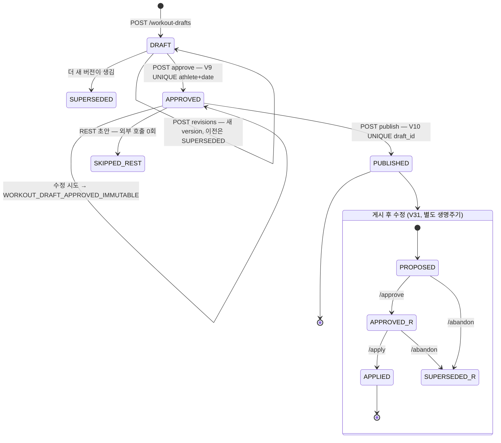
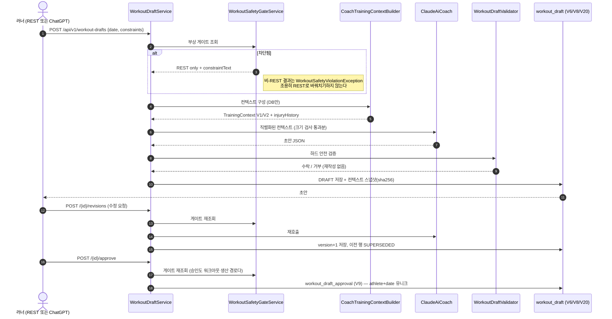
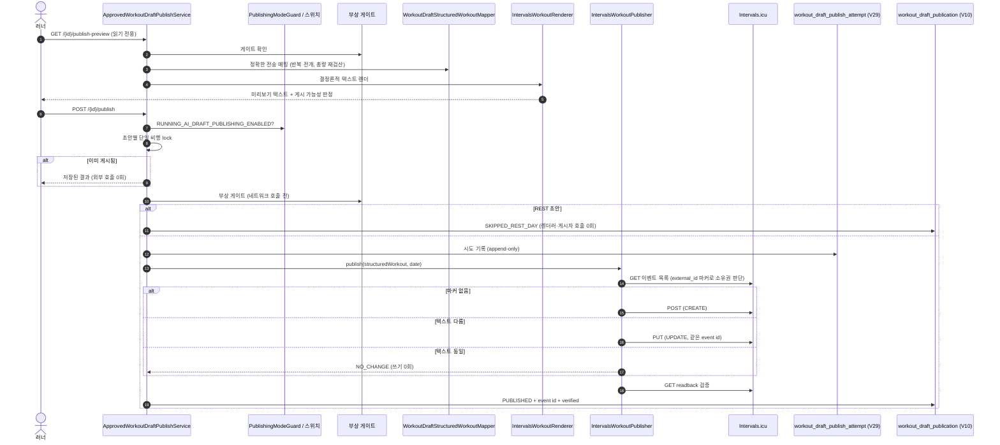
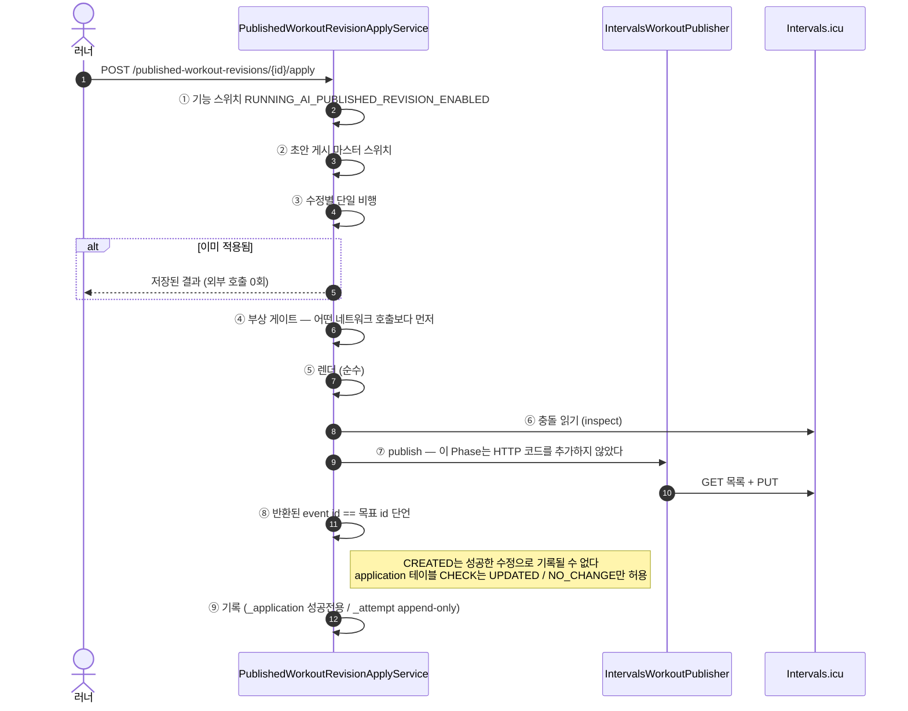
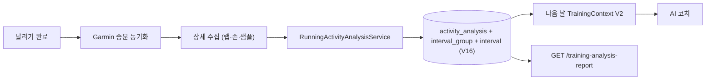

# 08. 훈련 생성 · 승인 · 게시 · 수정 · 결과 분석 시퀀스

> 대상 독자: 전원. 이 장이 RunningAI의 **심장**이다.

### 쉽게 말하면

운동 하나가 태어나서 시계에 도착하고, 바뀌고, 측정되기까지는 **6단계**다.

```
① 초안 생성 → ② (선택) 수정 → ③ 승인 → ④ 미리보기 → ⑤ 게시 → ⑥ 달리고 나서 분석
                                                      ↘ ⑤' 게시 후 수정 (Phase 10)
```

**③ 승인 전에는 아무것도 밖으로 안 나간다.** 승인은 돌이킬 수 없다 — 승인된 초안은
**불변(immutable)** 이고, 바꾸려면 ①부터 새로 만들거나(미게시), ⑤' 수정 경로를 쓴다(게시 후).

---

## 1. 상태 기계



> ⚠️ **용어 함정**: `POST /workout-drafts/{id}/revisions`는 **승인 전 초안의 버전 N+1**을
> 뜻하고, Phase 10의 "revision"은 **이미 게시된 워크아웃의 수정**이다. 그래서 Phase 10은
> `/{id}/revisions`를 재사용할 수 없었고 `/published-revisions`라는 별도 경로를 만들었다.

---

## 2. ① ~ ③ 생성 · 수정 · 승인 ✅ `SHIPPED`



**승인의 불변식**

| 규칙 | 강제 방법 |
| --- | --- |
| 선수+날짜당 승인 1건 | `UNIQUE (athlete_id, workout_date)` |
| 승인된 초안은 불변 | 수정 시도 → `WORKOUT_DRAFT_APPROVED_IMMUTABLE` |
| 승인은 DB만 | 외부 호출 0회 |
| 게시 스위치가 꺼져 있어도 승인·미리보기는 동작 | 스위치는 **게시만** 막는다 |

**MCP 경유 추가 요건**: `confirmedByAthlete: true` + `acknowledgedVersion` echo
([06장 §3](06-chatgpt-mcp-oauth.md)).

---

## 3. ④ ~ ⑤ 미리보기와 게시 ✅ `SHIPPED`



### 3.1 게시자의 불변식

| 규칙 | 이유 |
| --- | --- |
| **"re-list, never re-POST"** | 응답이 유실된 POST를 재시도하면 중복 이벤트가 생긴다. 대신 목록을 다시 읽어 실제 상태를 본다 |
| 소유권 마커 = `external_id` | 남의 이벤트를 절대 건드리지 않고, 동시에 멱등 키가 된다 |
| readback 검증 | 썼다고 믿지 않고 **다시 읽어** 확인한다 |
| 실패는 `workout_draft_publication`에 저장되지 않는다 | 그 테이블은 **성공 전용**. 실패 이력은 V29 원장에 |
| 저장소에서 Intervals에 쓰는 코드는 **단 하나** | `HttpIntervalsWorkoutClient` ← `IntervalsWorkoutPublisher` |

### 3.2 시도 원장 (V29)

| 컬럼 | 의미 |
| --- | --- |
| `external_write_attempted` | 외부 쓰기를 시도했는가 |
| `remote_state_certain` | **원격 상태를 확신하는가** — 타임아웃이면 **false** |

**두 컬럼이 별개인 이유**: 서로 다른 질문이다. "썼는지 모른다"는 "실패"가 아니다.
이 원장은 **아무 재시도도 유발하지 않는다.** 메시지가 아니라 **코드만** 저장한다.

조회: `GET /api/v1/workout-drafts/{id}/publish-attempts`

### 3.3 실측 상태

| 분기 | 상태 |
| --- | --- |
| UPDATE | ✅ 운영 3건 (event 140389091 · 140391756 · 140511724, 전부 verified=true) |
| CREATE | 🟢 dev DB에서 event 144442046 CREATED 성공. **운영 미실행** |
| REST | ✅ `SKIPPED_REST_DAY` |

---

## 4. ⑥ 게시물이 시계에 닿았는가 — 도달 확인

```
GET /api/v1/workout-drafts/{id}/delivery-status     (패키지 delivery)
```

| 판정 | 의미 |
| --- | --- |
| Intervals 측 | readback으로 **검증됨** |
| `GARMIN_NOT_FOUND` | **실패가 아니다.** Garmin 캘린더는 확정된 워크아웃만 돌려주고, Intervals→Garmin 푸시는 **Intervals.icu 자체 연동**이다 |
| `deviceDelivery` | **영구히 `UNKNOWN`** — 시계 도달은 어떤 API로도 증명 불가 |

계약 상태는 `STATIC_SOURCE_CONFIRMED` → Phase 8B 운영 릴리스에서 Garmin
`/scheduled-workouts`가 **live-verified** 되었다.

> `delivery` 패키지가 따로 있는 이유: `DraftPublishArchitectureTest`가
> `draftpublish → integration.garmin` 임포트를 금지한다.

---

## 5. ⑤' 게시 후 수정 (Phase 10) ✅ `SHIPPED`

### 5.1 왜 별도 생명주기인가

게시된 워크아웃을 바꾸려면 승인 이력을 건드려야 할 것 같지만, 그러면
`UNIQUE (athlete_id, workout_date)`(승인)와 `UNIQUE (draft_id)`(게시)와 **싸우게** 된다.
그래서 `published_workout_revision`(V31)은 **`workout_draft` / `workout_draft_approval` /
`workout_draft_publication` 중 아무것도 쓰지 않는다.** 그 셋은 **영원히 읽기 전용 입력**이다.

### 5.2 상태와 제약

```
PROPOSED → APPROVED → APPLIED        (+ SUPERSEDED: abandon 또는 대체)
```

**내용을 승인하는 것**과 **외부 쓰기를 인가하는 것**은 **두 개의 분리된 사람 결정**이다.

"게시물당 열린 수정은 최대 1건"은 nullable **`open_slot`**(열려 있으면 `publication_id`,
닫히면 NULL) 위의 **평범한 `UNIQUE` + `CHECK`** 로 강제된다.

> 🧩 **왜 PostgreSQL 부분 인덱스가 아닌가**: 테스트가 도는 H2로 이식되지 않기 때문이다.
> **로드베어링 규칙은 두 엔진에서 같은 메커니즘으로 강제되어야 한다.**

### 5.3 충돌 감지 — 쓰기 전에 거부

`base_text_sha256` = 정규화된 게시 텍스트의 SHA-256. **렌더링은 순수 함수이므로 다시 렌더해서
재도출했고, 그래서 백필이 필요 없었다.**

| 코드 | 상황 |
| --- | --- |
| `REVISION_REMOTE_EVENT_MISSING` | 대상 이벤트가 사라졌다 |
| `REVISION_REMOTE_EVENT_DUPLICATE` | 같은 마커가 둘 이상 |
| `REVISION_REMOTE_EVENT_REPLACED` | 다른 이벤트로 교체됐다 |
| `REVISION_REMOTE_EVENT_MODIFIED` | 외부에서 편집됐다 |

**네 가지 모두 어떤 쓰기도 일어나기 전에 거부한다.**

> 🔧 **Phase 10 감사에서 고친 것**: 충돌 검사가 **base뿐 아니라 제안된 텍스트도 수락**한다.
> 응답이 유실된 쓰기는 Intervals.icu에 **이 수정 자신의 출력**을 남기는데, 그것을 외부 편집으로
> 부르는 것은 틀렸을 뿐 아니라 **복구 불가능**했다 — 내용은 살아 있는데 원장은 적용된 적 없다고
> 말하는 상태. 수락해도 비용이 없고(덮어쓸 것이 없다), 게시자가 쓰기 없이 `NO_CHANGE`로 답한다.

> 🚪 **`abandon`은 풀리지 않는 충돌의 유일한 출구**: 게시물당 열린 수정이 1건이므로, 적용될 수
> 없는 수정은 **모든 후속 수정을 영구히 막는다.** `POST /{id}/abandon`이 `SUPERSEDED`로 닫는다 —
> 자동이 아니고, 외부 호출도 없고, 이미 종결된 수정에는 거부된다.

### 5.4 적용 순서 (순서 자체가 안전장치다)



**적용 비용 = GET 2회** — 이 서비스의 충돌 읽기 + 게시자 자신의 목록 조회. **중복이 아니다**:
게시자는 **자기가 읽은 것**으로 결정해야 한다. 새 읽기 전용
`IntervalsWorkoutPublisher.inspect(date)`가 게시자의 소유권 규칙을 재사용하므로 규칙이
복제되지도, 두 번째 쓰기 경로가 생기지도 않는다.

> 🚫 **어떤 것도 Intervals 이벤트를 삭제하지 않는다.**

### 5.5 REST / MCP 표면

```
POST|GET /api/v1/workout-drafts/{draftId}/published-revisions
GET      /api/v1/published-workout-revisions/{id}
POST     /api/v1/published-workout-revisions/{id}/approve
POST     /api/v1/published-workout-revisions/{id}/abandon
GET      /api/v1/published-workout-revisions/{id}/apply-preview
POST     /api/v1/published-workout-revisions/{id}/apply
```

MCP 6종은 같은 DTO·같은 코드를 쓰며, **세 커밋 호출 전부**(`approve` / `abandon` / `apply`)에
`confirmedByAthlete` + acknowledged echo가 요구된다.

**실측**: Phase 10 완료 시 수정 #1이 event 145043355에 `UPDATED`로 적용, **FR265에서 확인**.

---

## 6. ⑥ 결과 분석 ✅ `SHIPPED`



```
POST|GET /api/v1/activities/{activityId}/analysis
POST     /api/v1/activities/analysis-refresh[?dryRun=true]
```

재분석은 **모든 새 값이 존재한 뒤 한 트랜잭션에서 치환**되므로, 실패가 저장된 결과를
파괴하지 않는다. 스윕에서 실패한 활동은 **이전 분석을 유지**하고 스윕은 계속된다.

---

## 7. 전 생명주기에 걸친 "하지 않는 것"

| 하지 않는 것 | 이유 |
| --- | --- |
| 자동 게시 재시도 | 미지 상태의 POST를 반복하지 않는다 |
| 놓친 실행 보정 | 어제 못 한 운동을 오늘로 옮기지 않는다 |
| 알림 | 없음 |
| 코치 출력 재작성 | 검증기는 **수락 또는 거부**만 |
| 자동 부상 해제 | 시간 경과로 `RESOLVED`를 추론하지 않는다 |
| Intervals 이벤트 삭제 | 없음 |
| Garmin 쓰기 | 설계상 영구 부재 |
