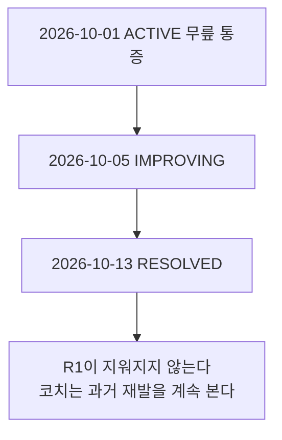
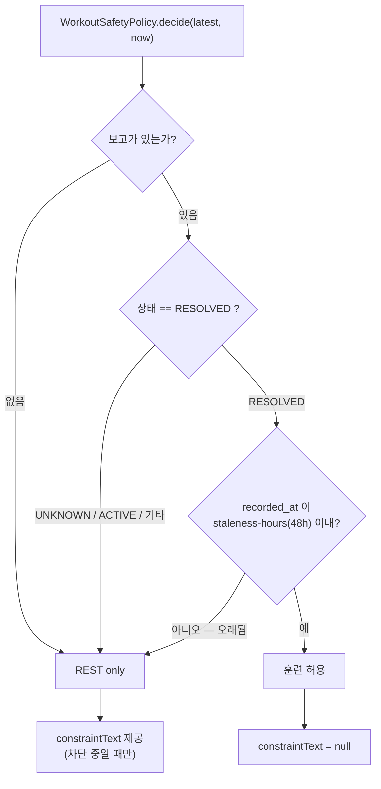
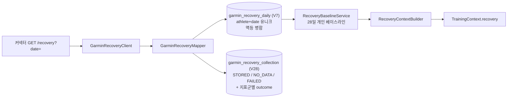
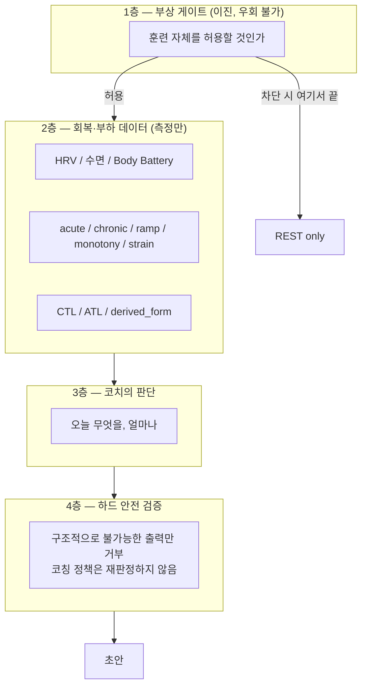

# 09. 부상 안전 게이트 · 회복 분석 · 훈련부하 관리

> 대상 독자: 전원. 이 장의 규칙은 **절대 약화하거나 우회하지 않는다**가 저장소 규칙이다.

### 쉽게 말하면

**부상 안전 게이트**는 "지금 운동을 만들어도 되는가"를 묻는 **단 하나의 판정자**다.
답은 둘 중 하나뿐이다.

- 내가 마지막으로 보고한 상태가 **"다 나았다(RESOLVED)"이고, 그 보고가 48시간 이내**일 때만
  → 평소 운동 허용
- 그 외 **전부** (보고 없음 / 모름 / 아픔 / 오래된 보고) → **휴식만**

중요한 점: **시간이 지났다고 저절로 나은 것으로 치지 않는다.** 나았다고 내가 말해야 한다.
그리고 `RESOLVED`는 **"내가 그렇게 보고했다"는 데이터 허가이지 의학적 완치 판정이 아니다.**

---

## 1. 부상 안전 게이트 ✅ `SHIPPED`

### 1.1 자가보고 원장 (`injury_report`, V21)

**추가 전용(append-only) 원장이다.** 상태 변화는 언제나 **새 행**이고 수정이 아니며,
어떤 것도 **진단이 아니다.**



### 1.2 "최신"의 정의 — 이것이 Phase 9의 핵심 수정

```sql
ORDER BY recorded_at DESC, id DESC     -- recorded_at 단독이 아니다
```

**왜 중요한가**: `recordedAt`은 `Instant.now(clock)`이다. 한 틱 안에 추가된 두 보고는
**시간으로 구분되지 않고**, 데이터베이스는 둘 중 아무거나 최신으로 돌려줄 자유가 있다.
그런데 이 원장에서 "최신"은 **훈련 허용 여부를 결정**한다.

> 🐛 **운영 실제 사례**: 운영 DB에 **0.5초 간격의 쌍**이 실존한다(동일 시각 RESOLVED 중복 2행,
> 2026-10-13 22:54:24.101553Z). 원인은 Phase 7F-3B-2B에서 규명됐다 — **셸의 `||`가 파이프라인
> 전체를 재시도**했다. append-only 특성상 삭제 대상이 아니며, 타이브레이크가 있으므로 게이트
> 판정에는 영향이 없다.

두 리포지토리 메서드 모두 이 타이브레이크를 갖고, 소비자는 **게이트(`current()`)** 와
**코치 컨텍스트(`history()`)** 둘뿐이다.

### 1.3 정책 — 단일하고 순수한 함수



| 입력 | 판정 |
| --- | --- |
| 보고 없음 | **REST only** |
| `UNKNOWN` | **REST only** |
| `ACTIVE` | **REST only** |
| 오래된 `RESOLVED` | **REST only** |
| 48시간 이내 `RESOLVED` | 훈련 허용 |

**`InjurySafetyDecision`은 이진값이다.** 설정은 `RUNNING_AI_INJURY_SAFETY_STALENESS_HOURS`(48).

### 1.4 모든 워크아웃 생산 경로가 같은 게이트를 지난다

전수 확인된 호출 지점 **6곳**:

| # | 경로 | 위치 |
| --- | --- | --- |
| 1 | 초안 생성 | `WorkoutDraftService` |
| 2 | 초안 수정 | `WorkoutDraftService` |
| 3 | 초안 승인 | `WorkoutDraftApprovalService` |
| 4 | 게시 미리보기 | `ApprovedWorkoutDraftPublishService` |
| 5 | 게시 | `ApprovedWorkoutDraftPublishService` |
| 6 | 레거시 결정론 게시 (→ 그 스케줄러와 MCP 도구까지) | `WorkoutPublishApplicationService` |

Phase 10의 **수정 적용(apply)** 도 **어떤 네트워크 호출보다 먼저** 게이트를 통과한다.
MCP read 도구는 같은 게이트를 **읽기만** 한다.

> 🚫 **차단된 비-REST 결과는 `WorkoutSafetyViolationException`이다. 조용히 휴식일로
> 바꿔치기되지 않는다.** 우회 경로는 없다.

### 1.5 코치에게 알리되, 허가하지는 않는다 (Phase 7F-3A)

게이트는 **차단 중일 때만** 말한다. 그래서 `RESOLVED` 상태에서는 코치가 **부상이 있었다는
사실조차 몰랐다.** `injuryHistory` 컨텍스트가 그 반대 방향만 보탠다 — 상세는
[07장 §2.4](07-ai-coaching.md).

**게이트는 불변이고, 모든 코치 호출 전후로 혼자 결정한다.**

### 1.6 API

```
POST /api/v1/athlete/injury-reports     새 보고 추가 (수정이 아니라 추가)
GET  /api/v1/athlete/injury-state       현재 게이트 판정
GET  /api/v1/athlete/injury-reports     원장 조회
```

---

## 2. 회복 분석

### 2.1 파이프라인 🟢 `BUILT`



**수집 지표** — HRV, 수면, 안정시 심박, Body Battery, 스트레스 (**문서화된 필드만**).

### 2.2 규칙

| 규칙 | 내용 |
| --- | --- |
| 멱등 병합 | **없는 지표가 저장된 지표를 지우지 않는다** |
| 베이스라인 창 | **28일**, 유효일 **7일 미만이면 `INSUFFICIENT_DATA`** |
| 측정만 | **등급·평가 없음** |
| 결정권 | **Spring은 회복 수치를 훈련 결정으로 바꾸지 않는다. 코치가 한다** |
| 트리거 | **수동 전용** — `POST /garmin/recovery-sync`, `/backfill`(≤28일, 순차, 재시도 없음, 첫 실패에서 중단) |
| 읽기 | `GET /api/v1/recovery-context` |

### 2.3 현재 공백

| 항목 | 실측 |
| --- | --- |
| `garmin_recovery_daily` | **21행** — 28일 창 미충족 |
| 베이스라인 운영 실증 | **없음** (`INSUFFICIENT_DATA` 반환 상태) |
| 라이브 검증 | 외부 PC `BLOCKED_BY_CORPORATE_TLS`, 메인 PC `PENDING` |

→ 감사 보고서 **P3-2**: 기존 backfill 엔드포인트만으로 해소 가능. 코드 변경 불필요.

---

## 3. 훈련부하 관리

### 3.1 RunningAI 자체 부하 (duration 기반) ✅ `SHIPPED`

```
GET /api/v1/training-load          (+ /weekly)
GET /api/v1/training-state
```

`training-state`가 내놓는 것: **acute / chronic, progression, ramp, monotony, strain.**
전부 **측정값이며 등급이 없다.**

- 정규화된 활동에서 **선수 타임존 기준**으로 계산
- **아무것도 영속화하지 않는다** — 매 호출 파생

### 3.2 Intervals.icu 부하 (CTL/ATL/Form) ✅ `SHIPPED`

`intervals_fitness_daily`(V18)에 저장되고 코치 컨텍스트에 **나란히** 제시된다.

### 3.3 두 부하를 섞지 않는다 — 명시적 비개발 결정 (P3-4)

> **"원칙을 유지하고 계산식을 바꾸지 말 것. 추가 개발 불필요 — 중복 개발 방지 항목으로
> 명시한다."** (감사 보고서 §P3-4)

| 값 | 소유자 | 용도 |
| --- | --- | --- |
| `training_load` (duration 기반) | RunningAI | 자체 부하 |
| Intervals `training_load` / `intensity` | Intervals.icu | **RunningAI 자체 계산에 쓰이지 않는다** |
| CTL / ATL / derived_form | Intervals.icu (+ form은 RunningAI 파생) | 코치 참고 |

**역할 분리 원칙**: 두 값을 **나란히 제시하는 일은 TrainingContext V2가 이미 한다.**
하나를 다른 하나로 대체하거나 혼합 계산식을 만들지 않는다.

### 3.4 결정 맥락 → 추천

```
GET /api/v1/training-decision-context
```

최근 일별 패턴, 마지막 러닝/롱런 이후 경과일, 연속 카운터, 부하 추세 라벨, 후보 훈련 타입.
**맥락일 뿐 처방이 아니다.**

> 📌 TrainingContext **V2는 `candidateTrainingTypes`를 담지 않는다** — 세션 선택은 코치의
> 일이기 때문이다. 이 엔드포인트는 결정론적 경로용이다.

설정: `long-run-min-duration` 90분, `stable-band-percent` 10%, `pattern-days` 14일.

---

## 4. 세 가지 안전장치의 관계



| 층 | 결정하는 것 | 결정하지 않는 것 |
| --- | --- | --- |
| 1층 게이트 | 훈련 가능 여부 | 무엇을 할지 |
| 2층 데이터 | 아무것도 | **측정만 한다** |
| 3층 코치 | 무엇을, 얼마나 | 밖으로 내보낼지 (사람이 승인) |
| 4층 검증 | 구조적 불가 거부 | **코칭 정책 — 일부러 판정하지 않는다** |

---

## 5. 다이어그램

`diagrams/09-injury-gate.mmd` 참조.
