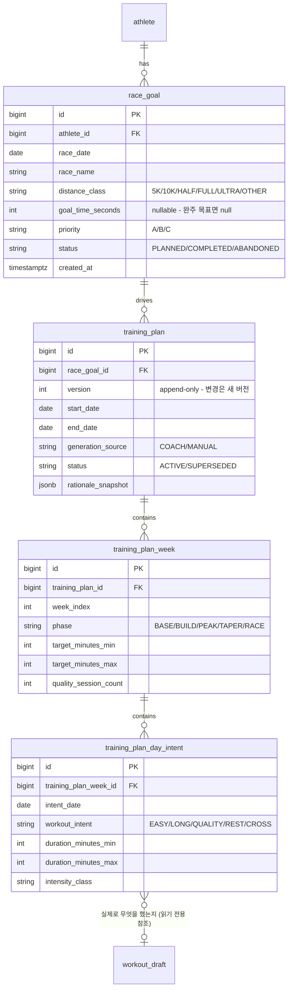
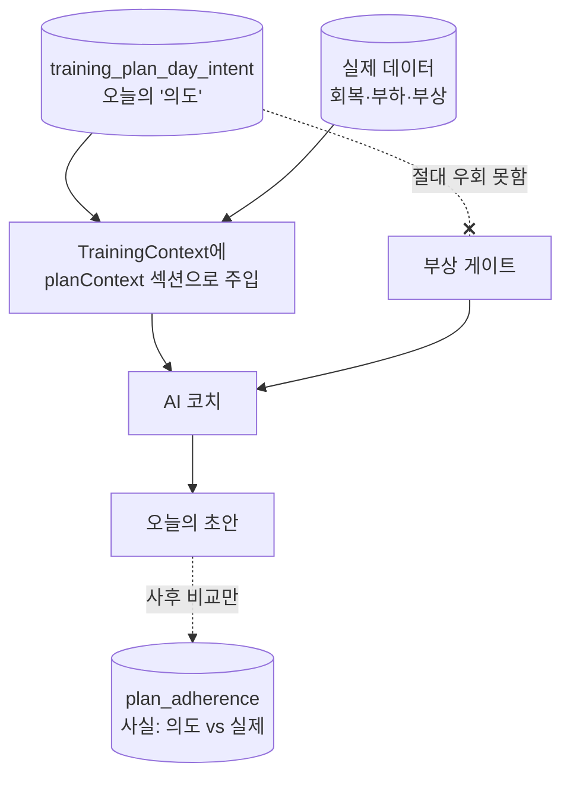

# 10. 장기 훈련 계획 및 대회 목표 관리

> ⚠️ **이 장은 대부분 🔵 `DESIGN`이다.** 현재 저장소에는 대회 목표·장기 계획·주기화
> (periodization) 기능이 **존재하지 않는다.** 아래는 본 문서가 **Phase 11로 제안하는 설계안**이며,
> 저장소의 기존 불변식에서 도출했다. 구현·검증되었다고 주장하지 않는다.

---

## 1. 현재 상태 — 사실 먼저

### 1.1 지금 있는 것

| 기능 | 상태 | 시야 |
| --- | --- | --- |
| 오늘 하루의 워크아웃 초안 | ✅ `SHIPPED` | **D일 1일** |
| 훈련 결정 맥락 (최근 패턴 14일) | ✅ `SHIPPED` | 과거 14일 |
| 훈련 상태 (acute/chronic, ramp, monotony, strain) | ✅ `SHIPPED` | 과거 28일 |
| CTL/ATL 추세 | ✅ `SHIPPED` | 과거 |
| 훈련 분석 리포트 (보유 이력 전체) | 🟢 `BUILT` | 과거 전체 |

### 1.2 지금 **없는** 것

| 항목 | 상태 | 확인 근거 |
| --- | --- | --- |
| 대회 목표(race goal) 엔티티 | ⛔ `ABSENT` | 코드·마이그레이션 전수 검색 결과 없음 |
| 주/월/시즌 단위 계획 | ⛔ `ABSENT` | 동일 |
| 주기화(base/build/peak/taper) | ⛔ `ABSENT` | 동일 |
| 목표 페이스 / 레이스 페이스 | ⛔ `ABSENT` | CLAUDE.md "Planned, not started"에 명시 |
| RPE 모델 | ⛔ `ABSENT` | 동일 |
| 미래 날짜 계획 생성 | ⛔ `ABSENT` | 컨텍스트는 **엄격한 no-look-ahead** |

> 📌 **핵심 사실**: TrainingContext는 **날짜 `D` 이후의 어떤 것도 포함하지 않는다**(엄격한
> no-look-ahead). 현재 구조는 "오늘 무엇을 할까"에 최적화되어 있고, **미래를 내다보는 개념이
> 아예 들어 있지 않다.** 장기 계획은 기능 추가가 아니라 **새로운 시간 축의 도입**이다.

### 1.3 현실적 제약

보유 데이터는 **2026-06-02 ~ 2026-10-11, 약 4.5개월**이다. 16주 마라톤 계획 하나와 비슷한
길이이며, **여러 시즌에 걸친 주기화를 데이터로 뒷받침할 이력이 아직 없다.**

---

## 2. 🔵 `DESIGN` — Phase 11 제안: 대회 목표와 장기 계획

### 2.1 설계 원칙 (기존 불변식에서 도출)

| 원칙 | 적용 |
| --- | --- |
| **계획은 처방이 아니다** | 계획은 "의도와 제약"을 담고, **그날의 워크아웃은 여전히 코치가 당일 데이터로 결정**한다. 계획이 당일 판단을 덮어쓰지 않는다 |
| **측정과 판단 분리** | 계획 엔진은 "남은 주 수", "주간 목표 볼륨 대비 실제" 같은 **사실**만 계산. "뒤처졌다/잘하고 있다"는 **코치의 말** |
| **부상 게이트 우선** | 계획이 무엇을 말하든 게이트가 먼저다. 계획은 게이트를 **절대 우회하지 못한다** |
| **append-only 선호** | 계획 변경은 수정이 아니라 **새 버전**. 왜 바뀌었는지가 남는다 |
| **no-look-ahead 유지** | 코치 컨텍스트에는 **과거 사실 + 계획의 의도**만 들어가고, **미래 활동 데이터는 존재할 수 없다** |
| **기본 OFF** | `RUNNING_AI_TRAINING_PLAN_ENABLED` = false |

### 2.2 제안 데이터 모델 (V32~V34 가정)



### 2.3 계획과 당일 코치의 관계 (가장 중요한 설계 결정)



| 질문 | 설계 답 |
| --- | --- |
| 계획이 오늘 QUALITY를 지시하는데 HRV가 나쁘면? | **코치가 결정한다.** 계획은 입력이지 명령이 아니다 |
| 계획을 벗어난 날은 실패인가? | **아니다.** `plan_adherence`는 **사실만 기록**하고 판정하지 않는다 |
| 계획이 자동으로 재생성되는가? | **아니다.** 재계획은 **사람이 요청**하고 새 `version`을 만든다 |
| 계획이 워크아웃을 자동 게시하는가? | **절대 아니다.** 게시 경로는 변경 없이 승인 → 게시 그대로 |

### 2.4 제안 API

```
POST   /api/v1/race-goals                         목표 등록
GET    /api/v1/race-goals
PATCH  /api/v1/race-goals/{id}                    상태 변경 (COMPLETED/ABANDONED)
POST   /api/v1/race-goals/{id}/training-plans     계획 생성 (코치 또는 수동)
GET    /api/v1/training-plans/{id}
GET    /api/v1/training-plans/{id}/adherence      사실 비교 (판정 없음)
GET    /api/v1/training-plans/active?date=        오늘의 의도 (코치 컨텍스트 입력)
```

MCP 도구 추가 시 스코프는 **`runningai:train`** (게시가 아니므로 `publish`가 아니다).

### 2.5 선행 조건 (이것들 없이는 설계만 남는다)

| 선행 조건 | 현재 상태 |
| --- | --- |
| 레이스 페이스 모델 | ⛔ `ABSENT` — 목표 시간에서 훈련 페이스를 도출하려면 필요 |
| QUALITY 워크아웃 구조 (결정론 경로) | ⛔ `ABSENT` — AI 경로에는 존재하므로 계획이 AI 경로만 쓰면 우회 가능 |
| 충분한 이력 | 4.5개월 — 주기화 검증에는 부족 |
| 데이터 신선도 | Garmin 자동 동기화가 켜져야 계획 추적이 의미를 가진다 (Phase 9 Stage 4) |

### 2.6 제안하지 **않는** 것

| 안 하는 것 | 이유 |
| --- | --- |
| 계획이 매일 자동으로 워크아웃을 만들고 게시 | 사람 승인 원칙 위반 |
| "계획 준수율 점수" | 측정/판단 분리 원칙 위반 — 사실만 제시 |
| 인구 규준 기반 목표 시간 추정 | 검증기 철학("만들어낸 인구 규준 금지")과 충돌 |
| 계획 변경 시 과거 행 수정 | append-only 원칙 위반 |

---

## 3. 🔵 `DESIGN` — 중간 단계: 목표 없이도 되는 것

Phase 11 전체가 부담스러우면, 다음 두 개는 **독립적으로** 가치가 있고 위험이 낮다.

| 항목 | 설명 | 의존성 |
| --- | --- | --- |
| **대회 목표만 (계획 없이)** | `race_goal` 1테이블 + 코치 컨텍스트에 "D-42, 하프, 목표 1:45" 한 줄 주입. 코치가 알아서 역산한다 | 없음 |
| **주간 의도 (단일 주)** | 다음 7일의 의도만. 주기화 없음 | 없음 |

> 💡 **권고**: 대회 목표 1개 테이블 + 컨텍스트 한 줄이 **가장 낮은 비용으로 가장 큰 체감
> 변화**를 만든다. 코치는 이미 맥락을 읽고 판단하는 능력이 있으므로, 목표를 알려 주는 것만으로
> 세션 선택이 달라진다.

---

## 4. 요약 표

| 기능 | 현재 | Phase 11 제안 |
| --- | --- | --- |
| 대회 목표 | ⛔ | 🔵 `race_goal` |
| 장기 계획 | ⛔ | 🔵 `training_plan` + 주/일 의도 |
| 주기화 | ⛔ | 🔵 `phase` 컬럼 (BASE/BUILD/PEAK/TAPER/RACE) |
| 계획 준수 추적 | ⛔ | 🔵 사실만 기록 |
| 레이스 페이스 | ⛔ | 🔵 선행 조건 |
| 자동 실행 | ⛔ | 🔵 **제안하지 않음** (영구 비목표) |
