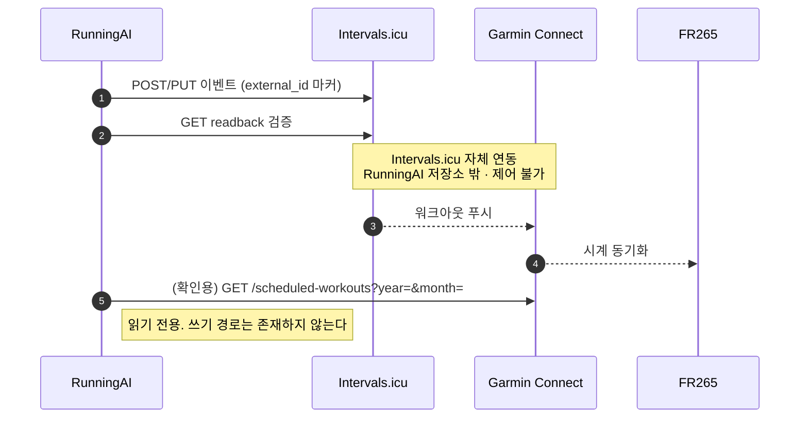
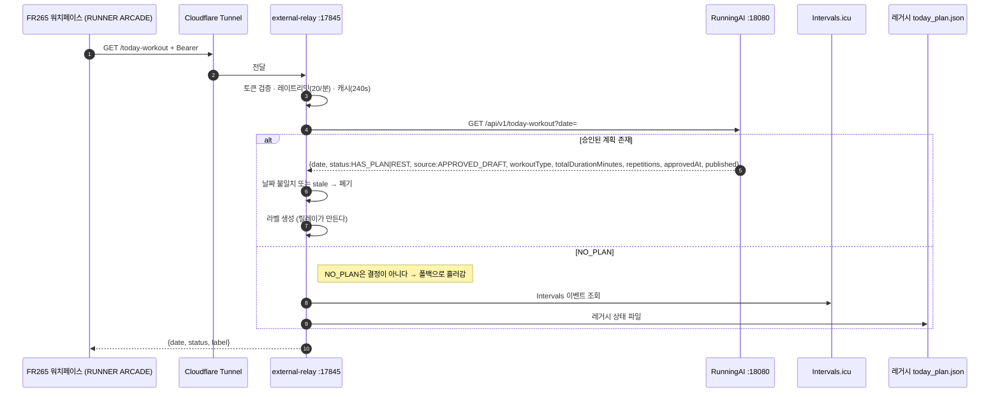

# 11. Garmin FR265 워치페이스와 동기화

> 대상 독자: 🏃 일반 러너 · 💻 백엔드 개발자

### 쉽게 말하면

시계에 오늘 운동이 나타나는 길은 **두 개**이고, 둘은 전혀 다른 경로다.

| | ① 구조화된 워크아웃 | ② 워치페이스 한 줄 |
| --- | --- | --- |
| 무엇 | 시계에서 실행하는 인터벌 프로그램 | 시계 화면의 "오늘 뭐 뛰지" 텍스트 |
| 경로 | RunningAI → Intervals.icu → **Intervals 자체 연동** → Garmin Connect → 시계 | RunningAI → 릴레이 → 터널 → 워치페이스 앱 |
| RunningAI가 직접 쓰는가 | **아니다** (Intervals까지만) | **아니다** (릴레이가 읽어간다) |
| 검증 | Intervals readback ✅ / 시계 도달 ❌ | 릴레이 응답까지 ✅ |

**RunningAI는 Garmin에 아무것도 쓰지 않는다.** 이건 한계가 아니라 **설계**다.

---

## 1. 경로 ① — 구조화된 워크아웃



### 1.1 RunningAI가 보장하는 범위

| 단계 | 보장 |
| --- | --- |
| Intervals에 썼는가 | ✅ **readback으로 검증됨** |
| Garmin 캘린더에 있는가 | 🟡 `GET /scheduled-workouts`로 **조회 가능** (live-verified, Phase 8B) |
| 시계에 떴는가 | ❌ **`deviceDelivery` = 영구 `UNKNOWN`** |

### 1.2 `GARMIN_NOT_FOUND`는 실패가 아니다

Garmin 캘린더는 **확정된 워크아웃만** 돌려준다. 그리고 Intervals→Garmin 푸시는
**Intervals.icu 자체 연동**이다. 따라서 "없음"은 "RunningAI가 실패했다"가 아니라
"아직/또는 영영 푸시되지 않았다"일 수 있다. **추측하지 않고 사실만 보고한다.**

### 1.3 쓰기 경로는 추가할 수 없다

커넥터 테스트가 소스 AST를 파싱해 다음이 등장하면 **빌드를 실패**시킨다.

```
schedule_workout   upload_*_workout   push_workout_to_device
```

그리고 **모든 라우트가 GET임을 단언**한다. 이것이 "Garmin에 쓰지 않는다"를 문서가 아니라
**빌드가 지키게** 만든 장치다.

### 1.4 기기 검증 이력

| 검증 | 범위 |
| --- | --- |
| `DEVICE_VERIFIED` (Phase 5C-4) | Pace, %LTHR, 트레드밀 큐가 FR265에서 정상 표시 — **사람의 육안 1회** |
| Phase 10 (2026-10-16) | 수정 #1(event 145043355 `UPDATED`)이 **FR265에서 확인됨** |

> 📌 `M:SS/km Pace` Workout Builder 문법은 FR265에서 검증됐다. **러닝 파워 문법은 검증되지
> 않았고, 그래서 게시가 거부된다** ([07장 §3.4](07-ai-coaching.md)).

---

## 2. 경로 ② — 워치페이스 릴레이



### 2.1 와이어 계약은 바뀌지 않는다

```json
{ "date": "2026-10-16", "status": "HAS_PLAN", "label": "EASY 50M" }
```

**이미 설치된 워치페이스가 이 계약으로 동작한다. 한 글자도 바꾸지 않는다.**

### 2.2 `GET /api/v1/today-workout`의 설계 (Phase 8B-D)

| 필드 | 설명 |
| --- | --- |
| `status` | `HAS_PLAN` / `REST` / `NO_PLAN` |
| `source` | `APPROVED_DRAFT` / `NONE` — **"RunningAI가 결정했다"와 "아무것도 결정하지 않았다"를 구분** |
| `workoutType` | EASY / RECOVERY / LONG / THRESHOLD / INTERVAL / TEMPO / CROSS_TRAINING (REST·NO_PLAN이면 null) |
| `totalDurationMinutes`, `repetitions` | 구조 |
| `approvedAt`, `published` | 승인 시각 / Intervals 도달 여부 |
| `stale` | 캐시·오배송을 소비자가 **탐지 가능**하게 |
| **`title`** | **일부러 없다** — 단순히 안 쓰는 게 아니라 **계약에서 제외** |

> 🎨 **왜 제목을 안 주는가**: 릴레이가 받은 것은 **14글자 디스플레이**와 숫자·A-Z·소수 기호만
> 커버하는 픽셀 폰트를 가진 기기로 간다. 구조화된 타입과 시간을 주면 릴레이가 **자기가 아는
> 값으로 라벨을 만든다.** 코치가 쓴 제목을 주면 **모델이 생성한 자유 텍스트가 디스플레이
> 문자열이 된다.** 코치 자유 텍스트는 이 경계를 넘지 않는다.

> 🏠 **왜 `draftpublish` 패키지에 있는가**: `CoachArchitectureTest`가 `coach → draftpublish`
> 임포트를 금지하기 때문이다.

### 2.3 릴레이의 보안 자세

| 항목 | 값 |
| --- | --- |
| 바인드 | `127.0.0.1` **하드코딩** — cloudflared가 앞단 |
| 인증 | `secrets/watch-token.json`의 단일 장수명 Bearer |
| **이 토큰은 Intervals API 키가 아니다** | 이미 요약된 오늘 계획 GET **하나만** 허가 |
| 토큰 노출 전제 | PRG를 디컴파일하면 읽힌다 → 빌드 공유 시 `generate-token.js`로 **회전** (서버 변경 불필요) |
| 로그 | `authorization` / `token` / `api_key` 패턴 **정규식 마스킹** |
| 레이트리밋 / 캐시 | 분당 20회 / 240초 |

### 2.4 폴백 정책

```
① Spring /api/v1/today-workout   ← 승인된 AI 초안이 시계에 도달하는 경로
② Intervals.icu 직접 조회
③ 레거시 C:\running-ai\state\today_plan.json
```

- `config.spring_base_url = ""` → **8B 이전 동작으로 정확히 복귀**
- **날짜가 틀리거나 `stale` 플래그가 붙은 답은 버린다**
- **`NO_PLAN`은 결정이 아니므로** 폴백으로 흘러간다 (REST는 결정이므로 흘러가지 않는다)

---

## 3. 현재 공백과 위험

| 항목 | 상태 | 비고 |
| --- | --- | --- |
| 워치페이스 앱 소스 (`C:\running-ai-watchface`) | ⛔ **저장소 밖** | 버전 관리되지 않음. 편입은 우선순위 최하(P4-3) |
| 외부 전송 경로 | 🟡 ad-hoc Cloudflare **Quick Tunnel** | **재부팅마다 호스트명 소멸** |
| 시계 도달 기계 확인 | ⛔ 불가 | `deviceDelivery` 영구 UNKNOWN |
| 릴레이 인증 | 🟡 Bearer 단일 토큰 | 공개 노출 범위 재검토 필요 |

### 3.1 🔵 `DESIGN` — Phase 12 제안: 전송 경로 안정화

| 선택지 | 비용 | 효과 |
| --- | --- | --- |
| (a) **Cloudflare Named Tunnel** | **무료**, 계정만 필요 | **고정 호스트명** → 재부팅 후 사람 개입 0 |
| (b) 현행 유지 + 재부팅 절차 문서화 | 0 | 개입이 1단계로 축소 |

> 💡 같은 문제가 MCP 터널에서 2026-10-14에 실측됐다. **Quick Tunnel의 호스트명은 프로세스
> 수명과 같다** — 그래서 워치독이 터널을 **절대 재시작하지 않는다**([15장](15-operations-and-security.md)).

---

## 4. 다이어그램

`diagrams/10-watch-delivery.mmd` 참조.
