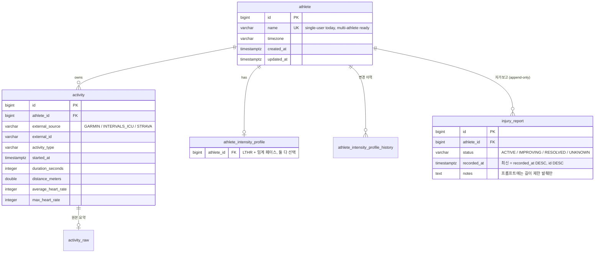
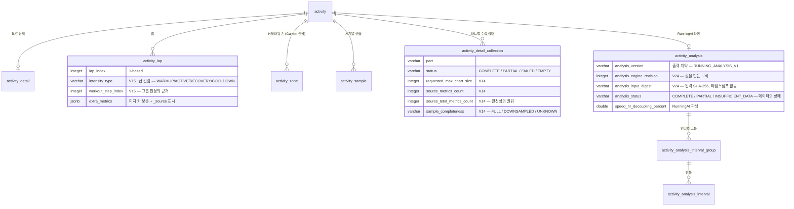
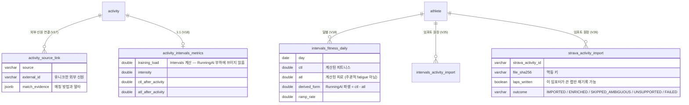
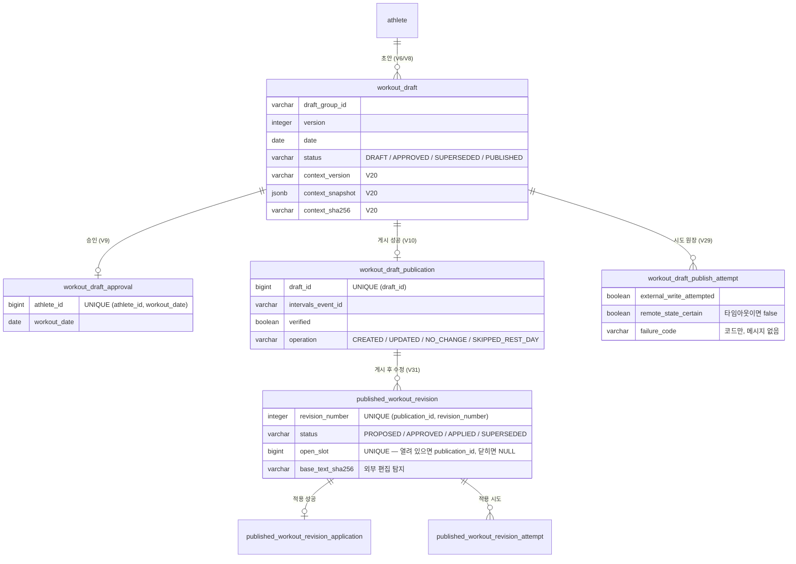

# 12. PostgreSQL 핵심 데이터 모델

> 대상 독자: 💻 백엔드 개발자
> 현재 마이그레이션: **V1 ~ V31** (다음 사용 가능 번호: **V32**)

### 쉽게 말하면

테이블은 **33개**이고, 역할에 따라 6개 묶음으로 나뉜다.

| 묶음 | 테이블 수 | 한 줄 |
| --- | --- | --- |
| 선수·활동 | 5 | 누가, 무엇을 뛰었나 |
| 원본 보관 | 3 | 외부가 보낸 것을 **손대기 전에** 그대로 |
| 상세·분석 | 9 | 그 안에서 실제로 무슨 일이 있었나 |
| 외부 보강 | 5 | Intervals·Strava가 아는 것 |
| 워크아웃 생명주기 | 7 | 초안 → 승인 → 게시 → 수정 |
| 관측·작업 기록 | 4 | 무엇이 실행됐고 무엇이 실패했나 |

---

## 1. 전역 규칙

| 규칙 | 내용 |
| --- | --- |
| 스키마 소유자 | **Flyway만.** Hibernate는 `ddl-auto: validate` |
| 적용된 마이그레이션 | **절대 수정하지 않는다.** 변경은 새 `V<N>__*.sql` |
| 시간 | **UTC `TIMESTAMPTZ` / `Instant`** |
| 외부 신원 | **`external_source + external_id`**. 내부 PK는 **절대 외부 ID가 아니다** |
| PK | `BIGINT GENERATED BY DEFAULT AS IDENTITY` |
| 제약 이식성 | 테스트는 H2, 운영은 PostgreSQL → **로드베어링 제약은 두 엔진에서 같은 메커니즘**이어야 한다 |
| 엔티티 노출 | **금지.** DTO는 Java record |
| JSONB | 원본 payload, `extra_metrics`, 컨텍스트 스냅샷 |

---

## 2. 선수 · 활동



> 🔑 **`(external_source, external_id)` 유니크**가 활동 신원의 전부다. 같은 운동이 세 소스에
> 있어도 **행은 하나**이고, 두 번째 소스는 `activity_source_link`로 붙는다.

> ⚠️ **`injury_report`의 정렬**: `recorded_at` 단독은 안 된다. 같은 틱에 추가된 두 보고가
> 시간으로 구분되지 않고, 이 원장에서 "최신"은 **훈련 허용 여부를 결정**한다
> ([09장 §1.2](09-safety-recovery-load.md)).

---

## 3. 원본 보관 (Raw-First)

| 테이블 | 마이그레이션 | 담는 것 |
| --- | --- | --- |
| `activity_raw` | V3 | Garmin 요약 원본 (JSONB) |
| `activity_raw_payload` | V11 | 활동+파트별 원본 (detail / splits / hr-zones / power-zones / samples / INTERVALS 스트림) |
| `intervals_raw_payload` | V18 | Intervals `ACTIVITY` / `WELLNESS_DAY` |

**각각 독립 커밋**된다. 매퍼 버그가 데이터 손실이 되지 않고, `reprocess`가 **외부 호출 0회**로
가능한 근거다.

---

## 4. 상세 · 분석



| 마이그레이션 | 추가한 것 |
| --- | --- |
| V12 | `activity_detail` / `activity_lap` / `activity_zone` / `activity_sample` |
| V13 | `activity_detail_collection` (파트별 상태) |
| V14 | 샘플 충실도 4컬럼 |
| V15 | 랩의 `intensity_type` / `workout_step_index` **1급 컬럼화** |
| V16 | `activity_analysis` + 인터벌 그룹/반복 |
| V22 | 러닝 다이내믹스 (engine revision 2) |
| V24 | 분석 신원 3요소 |

> 📏 **`analysis_input_digest`에 타임스탬프가 없는 이유**: 같은 데이터를 다시 수집한 것은
> **데이터 변경이 아니다.** 그래서 재수집이 불필요한 재분석을 유발하지 않는다.
> 반대로 **같은 개수의 더 풍부한 랩으로 교체**되면 digest가 못 알아보므로, 데이터를 바꾼
> 컴포넌트(Strava 임포터)가 **스스로 `analyse()`를 호출**한다.

---

## 5. 외부 보강



> 🧾 **V25 / V26의 한 행이 5역할을 한다**: 멱등 키 · 재개 지점 · 진행 로그 · 품질 기록 ·
> 교차 시스템 출처. **재-POST가 곧 재개이자 재시도**다.

---

## 6. 워크아웃 생명주기



### 6.1 세 개의 유니크가 서로 싸우지 않게 한 방법

| 제약 | 의미 |
| --- | --- |
| `workout_draft_approval UNIQUE (athlete_id, workout_date)` | Intervals 신원이 선수+날짜 단위이므로 |
| `workout_draft_publication UNIQUE (draft_id)` | 초안 이중 게시의 마지막 방어선 |
| `published_workout_revision` | **위 둘을 전혀 쓰지 않는다** — 그 셋은 **영원히 읽기 전용 입력** |

### 6.2 `open_slot` — 부분 인덱스를 쓰지 않은 이유

```sql
open_slot BIGINT,
CONSTRAINT uk_pwr_open_slot UNIQUE (open_slot),
CONSTRAINT ck_pwr_open_slot CHECK (
    (status IN ('PROPOSED','APPROVED') AND open_slot = publication_id)
    OR (status IN ('APPLIED','SUPERSEDED') AND open_slot IS NULL)
)
```

- `UNIQUE`는 **두 엔진 모두 NULL을 무시**하므로, 닫힌 수정은 슬롯을 점유하지 않는다.
- `CHECK`가 컬럼을 **틀리게 만들 수 없게** 한다.
- **PostgreSQL 부분 인덱스는 H2로 이식되지 않는다.** 로드베어링 규칙은 같은 메커니즘이어야 한다.

### 6.3 적용 결과 제약

```sql
CONSTRAINT ck_pwra_operation CHECK (intervals_operation IN ('UPDATED','NO_CHANGE'))
```

→ **`CREATED`가 성공한 수정으로 기록될 수 없다.** 서비스가 반환된 event id == 목표 id를
단언하고, DB가 한 번 더 막는다.

---

## 7. 관측 · 작업 기록

| 테이블 | V | 성격 | 핵심 |
| --- | --- | --- | --- |
| `garmin_sync_state` | V4 | 체크포인트 | **성공한 것만**. 타임스탬프 NOT NULL |
| `garmin_sync_attempt` | V27 + V30 | **순수 관측** | 선수당 1행. `STARTED`/`SUCCESS`/`PARTIAL`/`FAILED`/`INTERRUPTED`, `consecutive_failure_count`, `consecutive_partial_count`, 성공 후에도 **살아남는** `last_failure_at` / `last_failure_code` |
| `garmin_recovery_daily` | V7 | 값 | 선수+날짜 유니크, 멱등 병합 |
| `garmin_recovery_collection` | V28 | **순수 관측** | 선수+날짜 1행(시도마다 치환). `STORED`/`NO_DATA`/`FAILED` + 5개 지표군의 `*_outcome` |
| `historical_backfill_run` / `_activity` | V19 | 작업 | 작업 단위당 1커밋 체크포인트 |

> 🚫 **어떤 코드도 관측 테이블을 읽고 "무엇을 가져올지" 결정하지 않는다.**

> 🧱 **왜 `garmin_sync_attempt`가 `garmin_sync_state`의 컬럼이 아닌가**: 후자의 타임스탬프는
> NOT NULL이라 **한 번도 성공한 적 없는 선수의 실패를 담을 수 없다.** 그리고 백필의
> "`garmin_sync_state`를 절대 건드리지 않는다" 불변식도 지켜진다.

> 🏷 **`*_outcome` vs `*_status`**: `garmin_recovery_daily.hrv_status`는 **Garmin 자신의
> 라벨**이다. 그래서 관측 컬럼은 이름이 겹치지 않게 `*_outcome`이다.

---

## 8. 마이그레이션 연대기

| 범위 | 주제 |
| --- | --- |
| V1–V5 | 기반: athlete / activity / activity_raw / sync_state / intensity_profile |
| V6–V10 | 워크아웃 생명주기: draft → approval → publication, 회복 일별 |
| V11–V16 | 상세 수집과 분석 엔진 |
| V17–V19 | 외부 소스 링크, Intervals 보강, 과거 백필 |
| V20–V24 | 컨텍스트 스냅샷, 부상 원장, 다이내믹스, 프로필 이력, 분석 신원 |
| V25–V26 | Intervals / Strava 임포트 원장 |
| V27–V28 | 수집 관측성 |
| V29–V30 | 게시 시도 원장, 동기화 생명주기 확장 |
| V31 | 게시 후 수정 |

**다음 사용 가능 번호: `V32`**

> ⚠️ **번호 충돌 사례**: 게시 시도 원장은 원래 V27로 계획됐으나 Phase 8A가 V27/V28을 먼저
> 썼다. 병행 개발 시 **다음 번호를 반드시 확인**할 것.

---

## 9. 다이어그램

`diagrams/11-erd-core.mmd` · `diagrams/12-erd-collection.mmd` 참조.
