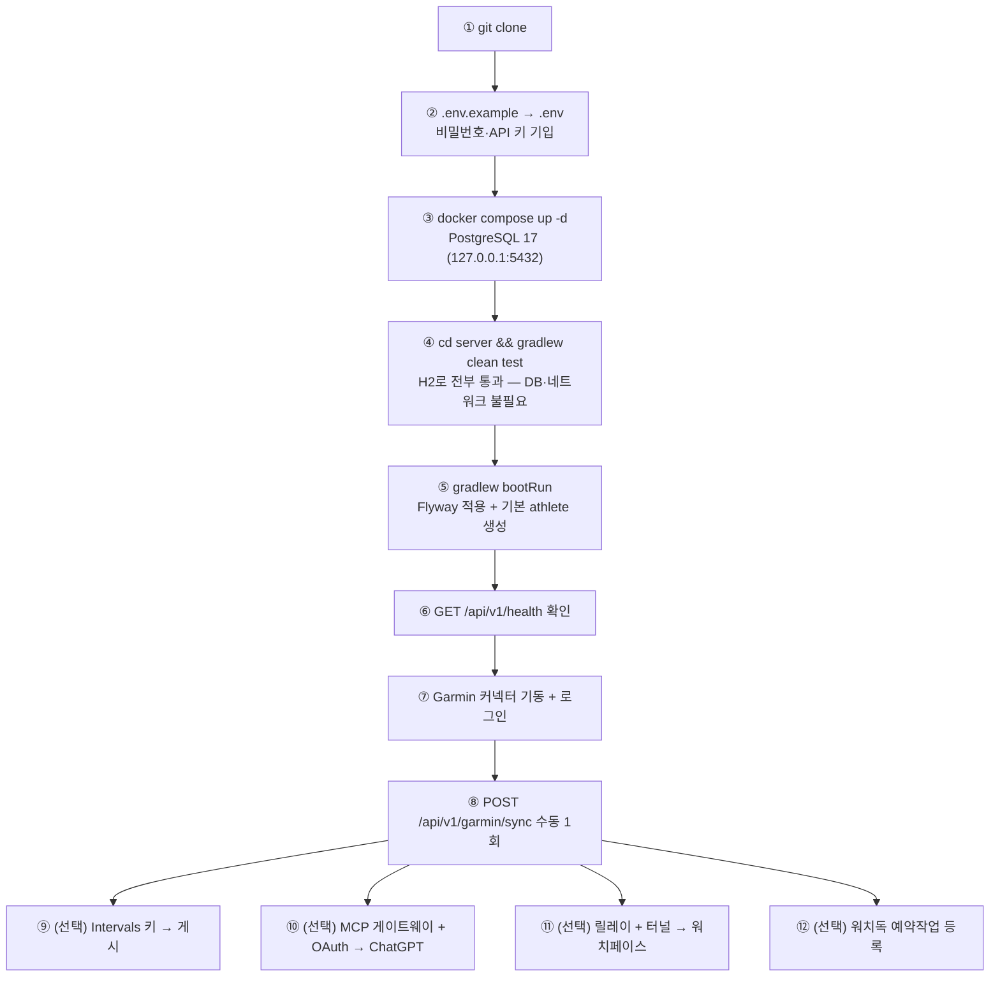
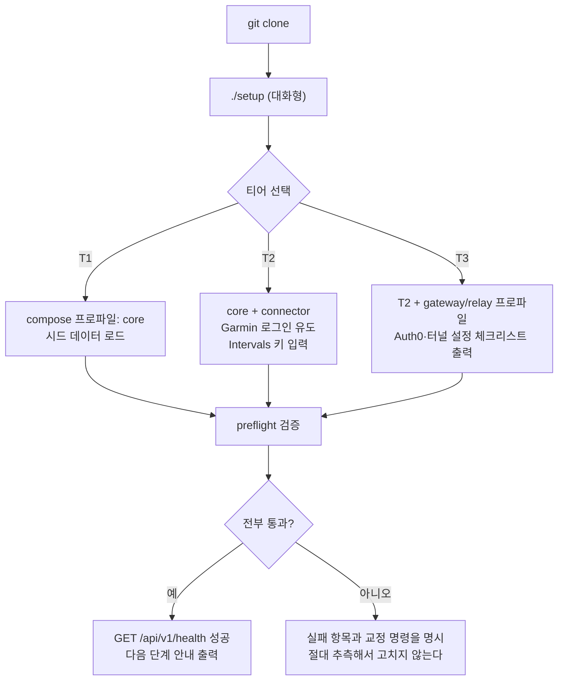

# 13. GitHub 공개 배포 및 신규 사용자 설치 흐름

> 대상 독자: 🧰 처음 설치하는 사용자 · 🛠 시스템 운영자
>
> ⚠️ **이 장은 혼합이다.** §1~§3은 **현재 실제로 동작하는 설치 절차**(✅/🟢)이고,
> §4~§6은 **공개 배포를 위한 🔵 `DESIGN` 제안**이다. 현재 저장소에는 설치 마법사·패키지
> 배포·공개 릴리스 파이프라인이 **없다.**

---

## 1. 현재 설치 요구사항 ✅ `SHIPPED`

### 쉽게 말하면

RunningAI는 **내 PC에서 직접 돌리는 프로그램**이다. 설치는 "앱 하나 받기"가 아니라
**4개를 준비하는 일**이다.

1. **데이터베이스** (Docker 한 줄)
2. **서버** (Gradle로 빌드 후 실행)
3. **Garmin 커넥터** (Python, 내 Garmin 계정으로 로그인)
4. **설정 파일** (`.env`에 비밀번호와 API 키)

ChatGPT 연동과 워치페이스는 **선택**이며, 둘 다 나중에 붙일 수 있다.

### 필수 준비물

| 항목 | 버전 | 비고 |
| --- | --- | --- |
| Java | **21** | Gradle toolchain이 요구 |
| Docker | 최신 | PostgreSQL 17 컨테이너용 |
| Python | 3.x | Garmin 커넥터용 |
| Node.js | 최신 LTS | MCP 게이트웨이 / 릴레이 (**선택**) |
| Garmin Connect 계정 | — | 필수 |
| Intervals.icu 계정 + API 키 | — | 게시 기능에 필수 |
| Claude Code CLI | 로그인된 상태 | AI 코치에 필수 |

> ⚠️ **알려진 환경 함정** (메인 PC 실측): 세션의 `JAVA_HOME`이 JDK 8을 가리키는 경우가 있다.
> PostgreSQL 테스트 실행 시 Hikari 풀을 2로 낮춰야 하고, Intervals 호출에는 User-Agent가 필요하다.

---

## 2. 현재 설치 절차 (단계별) ✅ `SHIPPED`



### 2.1 핵심 명령

```powershell
# ② 설정
Copy-Item .env.example .env     # 실제 값 기입 (절대 커밋 금지)

# ③ 데이터베이스
docker compose up -d
docker compose ps               # postgres 가 healthy 인지 확인

# ④ 테스트 (DB·네트워크 불필요, H2 + Flyway 실제 적용)
cd server
.\gradlew clean test

# ⑤ 실행
$env:DB_URL      = "jdbc:postgresql://127.0.0.1:5432/running_ai"
$env:DB_USERNAME = "running_ai"
$env:DB_PASSWORD = "<설정한 비밀번호>"
.\gradlew bootRun

# ⑥ 확인
Invoke-RestMethod http://localhost:8080/api/v1/health
```

> 📌 `DB_URL`에 `localhost` 대신 **`127.0.0.1`을 쓴다.** Docker가 IPv4로만 publish하는데
> `localhost`는 `::1`로 먼저 해석된다([04장 §1.7](04-components-and-protocols.md)).

### 2.2 프로파일

| Profile | DB | 스키마 | 용도 |
| --- | --- | --- | --- |
| `local` (기본) | PostgreSQL (환경변수) | Flyway + `validate` | 로컬 개발·운영 |
| `test` | H2 in-memory (PG 모드) | Flyway + `validate` | 자동화 테스트 |

**H2와 PostgreSQL의 알려진 차이**: H2에는 `JSONB`가 없어 `JSON`을 쓰고, timestamp 소수부를
microsecond로 반올림한다. **그 외 마이그레이션 SQL은 동일하게 적용된다.**

### 2.3 `.env` 설계

> **"모든 스위치는 소스 기본값과 함께 기재된다. `.env`에 없는 줄은 기본값과 정확히 같게
> 동작한다 — 이 파일은 완전할 필요가 없고 정확하기만 하면 된다."** (`.env.example` 머리말)

| 이 파일을 읽는 주체 | 읽는 값 |
| --- | --- |
| docker compose | `POSTGRES_*` |
| 서버 (`local` 프로파일) | `DB_*`, `SERVER_*`, `RUNNING_AI_*`, `GARMIN_*`, `INTERVALS_*`, `WORKOUT_*`, `RUNNINGAI_MCP_*` |
| `scripts\windows\*.ps1` | `SERVER_PORT`, `GARMIN_CONNECTOR_URL`, 게시·MCP 스위치 |
| `scripts\windows\external\*.ps1` | `RUNNING_AI_EXTERNAL_BASE_URL` |
| `tools\external-relay\server.js` | `INTERVALS_ICU_API_KEY` |

**실제 환경변수가 항상 이 파일보다 우선한다.**

MCP 게이트웨이의 값들은 **게이트웨이 자신의 환경**에 둔다(이 파일일 필요 없음):
`RUNNING_AI_OAUTH_ISSUER`, `..._AUDIENCE`, `..._ALLOWED_SUB`, `..._PUBLIC_BASE_URL`,
`..._REQUIRED_SCOPE`, `..._GATEWAY_PORT`, `..._GATEWAY_TARGET_URL`, `..._ALLOWED_TOOLS`.

---

## 3. Linux 배포 ✅ `SHIPPED`

```
deploy/linux/
├── systemd/
│   ├── running-ai.service
│   └── running-ai-garmin-connector.service
├── scripts/  install-runtime.sh · deploy-app.sh · status-running-ai.sh · validate-runtime.sh
└── env/      running-ai.env.example · garmin-connector.env.example
```

---

## 4. 🔵 `DESIGN` — 공개 배포가 되려면 무엇이 비는가

현재 저장소는 **한 사람의 PC를 위해 만들어졌다.** 공개 배포에는 다음 격차가 있다.

| 격차 | 현재 | 영향 |
| --- | --- | --- |
| **단일 사용자 전제** | 모든 서비스가 `getDefaultAthlete()` | 2명 이상 불가 → [14장](14-multi-user-isolation.md) |
| **설치 자동화 없음** | 12단계 수동 | 비개발자 진입 불가 |
| **릴리스 아티팩트 없음** | 소스에서 빌드 | Java/Gradle 환경 필요 |
| **운영 PC 전제 하드코딩** | `C:\running-ai\state\...` 등 레거시 경로 참조 | 다른 PC에서 의미 없음 |
| **OAuth 단일 주체** | `RUNNING_AI_ALLOWED_SUB` = 1명 | 각자 Auth0 테넌트를 직접 구성해야 함 |
| **비밀 관리 가이드** | `.env` 평문 | 공개 사용자에게 위험 |
| **문서 언어** | 한국어/영어 혼재 | — |

---

## 5. 🔵 `DESIGN` — Phase 14 제안: 공개 배포 설계

### 5.1 세 가지 설치 티어

| 티어 | 대상 | 구성 | 난이도 |
| --- | --- | --- | --- |
| **T1 — 읽기 전용 체험** | 처음 보는 사람 | docker compose 1개 (Postgres + 서버), 외부 연동 없음, 합성 시드 데이터 | ⭐ |
| **T2 — 개인 전체** | 러너 본인 | T1 + Garmin 커넥터 + Intervals 키 + Claude CLI | ⭐⭐ |
| **T3 — ChatGPT/워치 연동** | 고급 | T2 + Auth0 테넌트 + Cloudflare 터널 + 게이트웨이 + 릴레이 | ⭐⭐⭐⭐ |

### 5.2 제안 설치 흐름



### 5.3 설계 원칙 (기존 철학 계승)

| 원칙 | 적용 |
| --- | --- |
| **fail closed** | 설정이 불완전하면 **기동을 거부하고 무엇이 빠졌는지 이름을 밝힌다**. 게이트웨이가 이미 이렇게 한다 |
| **기본값은 전부 OFF** | 신규 설치는 **외부 쓰기가 전부 꺼진 상태**로 시작한다 |
| **설치 스크립트가 비밀을 생성하되 출력하지 않는다** | 릴레이 토큰은 `generate-token.js` 패턴 계승 |
| **레거시 경로 의존 제거** | `C:\running-ai\...` 참조는 **선택적 폴백**으로 강등 |
| **검증 가능한 설치** | `validate-runtime.sh` 패턴을 모든 플랫폼으로 |

### 5.4 제안 릴리스 아티팩트

| 아티팩트 | 내용 |
| --- | --- |
| `docker-compose.full.yml` | 프로파일(`core` / `connector` / `gateway` / `relay`)로 티어 선택 |
| 서버 컨테이너 이미지 | Java 런타임 포함 → JDK 설치 불필요 |
| 커넥터 컨테이너 이미지 | Python 환경 포함 |
| GitHub Release | 버전 태그 + 마이그레이션 번호 + **테스트 결과** 명시 |
| `SECURITY.md` | 비밀 취급, 노출 경계, 알려진 위험 |
| 이 명세서 기반 문서 사이트 | GitHub Pages |

> 🚫 **제안하지 않는 것**: 호스팅형 SaaS. 데이터가 사용자 PC를 떠나지 않는 것이 이 제품의
> 핵심 가치다([01장 V5](01-product-overview.md)).

---

## 6. 🔵 `DESIGN` — 신규 사용자 첫 7일 경험

| 일 | 목표 | 상태 |
| --- | --- | --- |
| D0 | 설치 + health 200 + Garmin 수동 동기화 1회 | T1/T2 |
| D1 | 첫 활동 상세 수집 + 분석 결과 확인 | — |
| D2 | 부상 보고 1건 등록 → 게이트가 열림 | **필수** — 보고가 없으면 영원히 REST only |
| D3 | 첫 AI 초안 생성 (게시 스위치는 OFF) | — |
| D4 | 미리보기로 렌더 텍스트 확인 | 외부 쓰기 0 |
| D5 | 게시 스위치 ON + 첫 실제 게시 | **되돌릴 수 있는 날짜로** |
| D6 | Intervals → Garmin → 시계 확인 | 육안 |
| D7 | 스케줄러 ON 여부 결정 | 24시간 관측 후 |

> 💡 **D2가 왜 필수인가**: 부상 보고가 하나도 없으면 게이트가 **REST only**를 반환한다
> (보고 없음 = 알 수 없음 = 안전 측). 신규 사용자가 "AI가 휴식만 추천한다"고 오해하기 가장
> 쉬운 지점이며, 설치 안내가 반드시 설명해야 한다.
