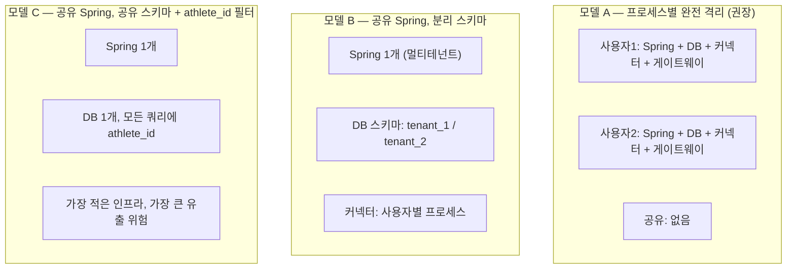
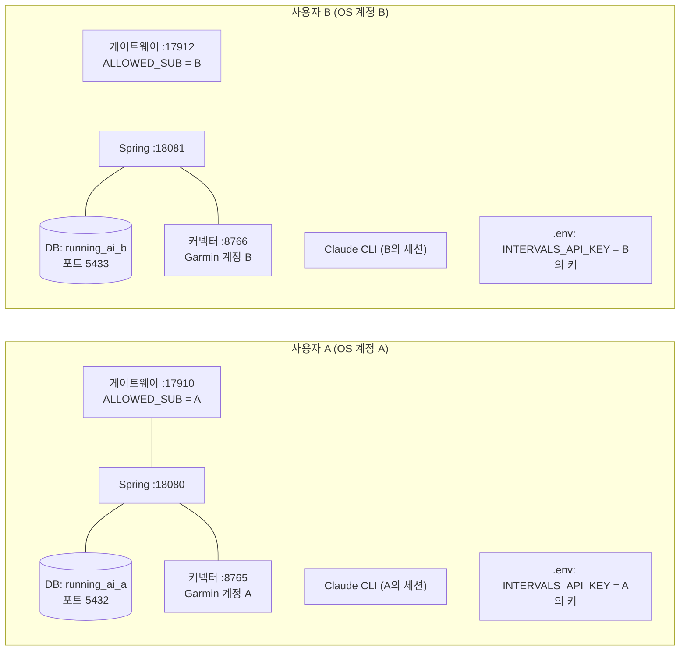
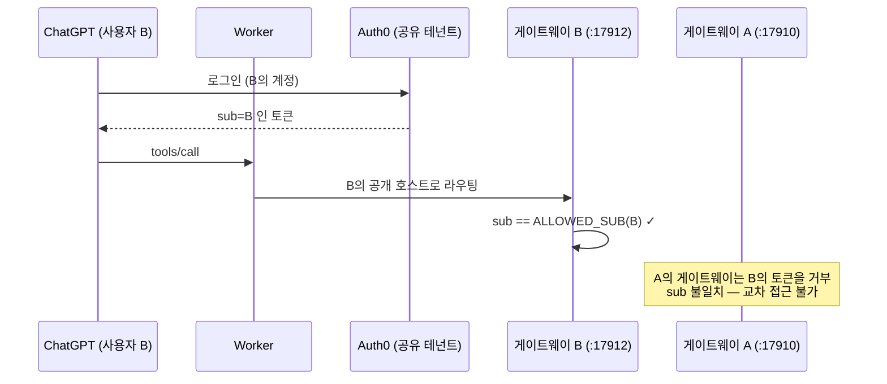

# 14. 사용자별 DB · 계정 · API 키 · OAuth 분리 구조

> ⚠️ **이 장은 전부 🔵 `DESIGN`이다.** 현재 RunningAI는 **단일 사용자 시스템**이며,
> 멀티 사용자 기능은 **구현되어 있지 않다.** 아래는 Phase 13으로 제안하는 설계안이다.

---

## 1. 현재 상태 — 왜 단일 사용자인가

### 1.1 코드가 말하는 것

```sql
-- V1__create_athlete.sql
-- Athlete: the owner of activities. Single-user today, multi-athlete ready.
```

**스키마는 처음부터 multi-athlete를 염두에 뒀다.** 거의 모든 테이블이 `athlete_id`를 갖고,
유니크 제약도 `(athlete_id, ...)` 형태다. 즉 **데이터 모델은 이미 준비되어 있다.**

### 1.2 그런데 무엇이 막는가

| 계층 | 현재 | 문제 |
| --- | --- | --- |
| **서비스** | 모든 서비스가 `athleteService.getDefaultAthlete().getId()` 호출 | **요청에 사용자 개념이 없다** |
| **설정** | `RUNNING_AI_ATHLETE_NAME` / `_TIMEZONE` 단일 값 | 선수가 설정으로 정해진다 |
| **외부 자격증명** | `INTERVALS_API_KEY` **프로세스 환경변수 1개** | 사용자별로 다를 수 없다 |
| **Garmin** | 커넥터 프로세스 1개 = 계정 1개 | 사용자별 커넥터가 필요 |
| **OAuth** | `RUNNING_AI_ALLOWED_SUB` = **정확히 1명** | 두 번째 사람이 들어올 수 없다 |
| **Claude CLI** | 호스트의 CLI 로그인 세션 | 사용자별 분리 없음 |
| **REST API** | 인증 없음 (루프백 전제) | 사용자 식별 수단 자체가 없음 |

**결론**: 데이터 모델은 90% 준비, **인증·자격증명·외부 연동은 0%**.

---

## 2. 🔵 `DESIGN` — Phase 13 제안: 격리 모델 선택

세 가지 격리 모델이 가능하며, 트레이드오프가 다르다.



| 기준 | A (프로세스 격리) | B (스키마 분리) | C (행 필터) |
| --- | --- | --- | --- |
| 코드 변경량 | **거의 없음** | 중간 | **매우 큼** |
| 데이터 유출 위험 | **최저** | 낮음 | **높음** (쿼리 하나만 빠뜨려도) |
| 외부 자격증명 분리 | 자연스러움 | 어려움 (프로세스 환경변수) | 어려움 |
| Claude CLI 분리 | OS 사용자로 가능 | 어려움 | 어려움 |
| 자원 비용 | 높음 | 중간 | 낮음 |
| 기존 불변식 보존 | **완전** | 부분 | **위험** |

> 💡 **권고: 모델 A.** 이 저장소는 **자가 호스팅 개인 시스템**이고, "데이터가 내 PC를 떠나지
> 않는다"가 핵심 가치다. 멀티테넌트 SaaS로 바꾸는 것은 제품 정체성의 변경이지 기능 추가가
> 아니다. **모델 A는 사실상 "각자 설치한다"** 이고, 공개 배포([13장](13-distribution-and-install.md))의
> 자연스러운 귀결이다.

---

## 3. 🔵 `DESIGN` — 모델 A의 구체 설계

### 3.1 격리 경계



| 자원 | 분리 방법 |
| --- | --- |
| **DB** | 데이터베이스 자체를 분리 (`running_ai_<user>`). 스키마 분리보다 강함 |
| **포트** | 사용자별 포트 블록 할당 (예: 18080+n, 8765+n, 17910+2n) |
| **OS 권한** | 각 사용자의 `.env`·`secrets/`는 해당 OS 계정만 읽기 |
| **Garmin** | 커넥터 프로세스 = 계정 1개 (현재 설계 그대로) |
| **Intervals** | 프로세스 환경변수 → 자연히 분리 |
| **Claude CLI** | OS 계정별 로그인 세션 |
| **OAuth** | 게이트웨이 인스턴스별 `RUNNING_AI_ALLOWED_SUB` |

### 3.2 코드 변경이 거의 필요 없는 이유

`getDefaultAthlete()`는 **프로세스당 선수 1명**을 뜻하고, 모델 A에서는 그것이 **정확히 맞는
의미**가 된다. `RUNNING_AI_ATHLETE_NAME`이 사실상 테넌트 식별자가 된다.

> ✅ **기존 불변식이 전부 보존된다**: 승인 유니크, 게시 유니크, 부상 게이트, 단일 비행,
> XOR 가드 — 전부 프로세스 안에서 성립하므로 손댈 필요가 없다.

### 3.3 필요한 최소 변경

| 변경 | 범위 |
| --- | --- |
| 포트 할당의 설정화 | 이미 대부분 환경변수. 게이트웨이/릴레이의 **하드코딩된 호스트는 유지**(루프백) |
| 설치 스크립트가 포트 블록을 계산 | 신규 |
| 워치독이 여러 인스턴스를 구분 | 현재도 **커맨드라인 마커**로 production 17910과 test 17911을 구분한다 → 같은 방식 확장 |
| 문서 | 포트 맵과 충돌 회피 |

---

## 4. 🔵 `DESIGN` — 그래도 모델 B/C가 필요하다면

진짜 멀티테넌트가 요구될 경우 **반드시 선행되어야 하는 것들**:

| 선행 조건 | 이유 |
| --- | --- |
| **REST API 인증 도입** | 현재 인증이 **전혀 없다**(루프백 전제). 테넌트 식별 수단이 없으면 격리가 불가능 |
| **`athlete_id` 필터의 기계적 강제** | 사람이 매 쿼리에 거는 방식은 **반드시 실패한다.** Hibernate 필터 / RLS(PostgreSQL Row Level Security) 같은 **빠뜨릴 수 없는** 수단 |
| **아키텍처 테스트 추가** | 이 저장소의 방식대로: 테넌트 컨텍스트 없이 리포지토리를 호출하면 **빌드 실패** |
| **외부 자격증명의 테넌트별 저장** | 환경변수로는 불가능 → 암호화 저장소 필요 → **새로운 공격면** |
| **Claude CLI의 테넌트 분리** | 현재 호스트 세션 1개. API 키 방식으로 바꾸면 비용·보안 모델이 전부 바뀜 |
| **감사 로그** | 누가 누구의 데이터를 읽었는가 |

> ⚠️ **정직한 평가**: 모델 C(공유 스키마 + 행 필터)는 코드 변경이 가장 크고 **유출 위험이
> 가장 높다.** 이 저장소의 "로드베어링 규칙은 기계가 강제한다" 철학과 맞추려면 RLS 수준의
> 강제가 필요하며, 그것은 **Phase 13 전체보다 큰 작업**이다.

### 4.1 PostgreSQL RLS를 쓸 경우의 문제

**테스트는 H2에서 돈다. H2에는 RLS가 없다.** [12장 §1](12-data-model.md)의
"로드베어링 제약은 두 엔진에서 같은 메커니즘" 원칙과 정면으로 충돌한다.

선택지는 셋이고 전부 비용이 있다.

| 선택 | 비용 |
| --- | --- |
| 테스트를 Testcontainers PostgreSQL로 이전 | 테스트 시간 증가, CI 복잡도 |
| 애플리케이션 계층 강제 + 아키텍처 테스트 | RLS만큼 강하지 않음 |
| 모델 A 채택 | **이 문제 자체가 발생하지 않음** |

---

## 5. 🔵 `DESIGN` — OAuth 다중 사용자

### 5.1 현재

```
RUNNING_AI_ALLOWED_SUB = <정확히 한 subject>
```

게이트웨이는 **토큰의 `sub`가 이 값과 다르면 거부**한다. 이것은 버그가 아니라 **의도된
단일 주체 설계**다.

### 5.2 제안 (모델 A 기준)



| 결정 | 설계 |
| --- | --- |
| Auth0 테넌트 | 공유 가능 (사용자마다 별도 `sub`) |
| 게이트웨이 | **사용자별 인스턴스**, 각자 `ALLOWED_SUB` 1개 |
| 공개 호스트 | 사용자별 터널 (Named Tunnel 권장 — [11장 §3.1](11-watch-integration.md)) |
| 스코프 | 변경 없음. `read` / `train` / `publish` 그대로, 비계층 유지 |
| 교차 접근 | **구조적으로 불가** — 게이트웨이가 다른 sub를 거부 |

> ✅ **이 설계의 장점**: 게이트웨이의 **현재 코드를 한 줄도 바꾸지 않는다.**
> `ALLOWED_SUB` 단일 주체 제약이 **그대로 격리 메커니즘이 된다.**

---

## 6. API 키 · 비밀 분리 요약

| 비밀 | 현재 위치 | 🔵 모델 A에서 |
| --- | --- | --- |
| Garmin 계정 | 커넥터 프로세스 (저장소 유일 보유자) | 사용자별 커넥터 프로세스 |
| `INTERVALS_API_KEY` | Spring 환경변수 | 사용자별 `.env` (OS 권한으로 분리) |
| DB 비밀번호 | `.env` | 사용자별 DB + 사용자별 비밀번호 |
| 워치 Bearer 토큰 | `tools/external-relay/secrets/watch-token.json` | 사용자별 릴레이 인스턴스 |
| OAuth 토큰 | 발급·검증만, **저장 안 함** | 변경 없음 |
| Claude 인증 | CLI 로그인 세션 (**API 키 미사용**) | OS 계정별 세션 |

> 🔒 **불변 규칙** (현재도, 미래에도): Garmin 자격증명·Intervals 키·실제 `.env`·개인 키·
> 실제 GPS 좌표·원시 사용자 payload는 **절대 커밋하지 않는다.** 자격증명·토큰·전체 원시
> payload는 **절대 로그하지 않는다.** `.env.example`에는 플레이스홀더만 둔다.

---

## 7. 요약

| 항목 | 현재 | 제안 |
| --- | --- | --- |
| 사용자 수 | **1** | 🔵 N (모델 A = N개 설치) |
| DB 분리 | 해당 없음 | 🔵 데이터베이스 단위 |
| API 키 분리 | 해당 없음 | 🔵 프로세스 환경 |
| OAuth 분리 | `ALLOWED_SUB` 1명 | 🔵 **코드 변경 없이** 인스턴스별 1명 |
| 데이터 모델 변경 | — | 🔵 **불필요** (이미 `athlete_id` 보유) |
| 멀티테넌트 단일 프로세스 | — | 🔵 **권장하지 않음** (§4) |
