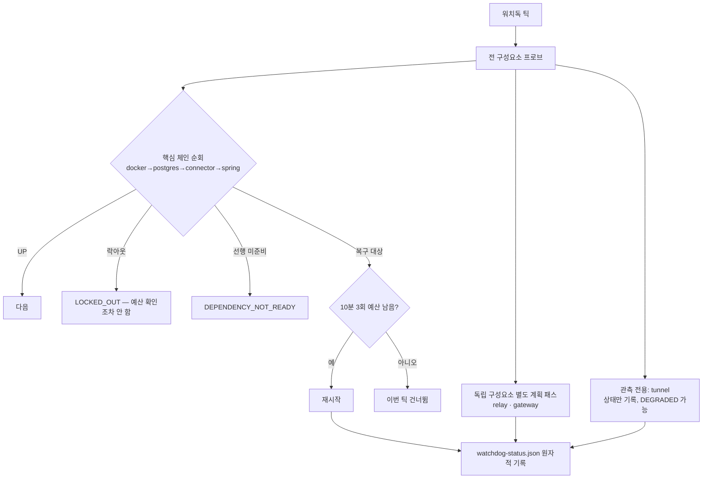

# 15. 운영 · 모니터링 · 장애 복구 및 보안 정책

> 대상 독자: 🛠 시스템 운영자 · 💻 백엔드 개발자

### 쉽게 말하면

RunningAI는 **내 PC에서 24시간 돌아야 하는** 시스템이다. 그래서 **워치독**이라는 감시
프로그램이 몇 분마다 모든 구성요소를 확인하고, 죽은 것을 되살린다.

다만 **되살리면 안 되는 것도 있다.** Cloudflare 터널을 재시작하면 **주소가 바뀌어서**
오히려 연결이 끊긴다. 그래서 워치독은 구성요소를 **세 등급**으로 나눈다.

| 등급 | 예 | 감시 | 복구 |
| --- | --- | --- | --- |
| 핵심 체인 | docker → postgres → connector → spring | ✅ | ✅ (의존 순서대로) |
| 독립 | external-relay, mcp-gateway | ✅ | ✅ (체인과 무관하게) |
| 관측 전용 | **tunnel** | ✅ | ❌ **절대 안 함** |

---

## 1. 워치독 ✅ `SHIPPED` (Phase 9)

### 1.1 세 범주

```powershell
$script:Components           = @('docker','postgres','connector','spring')   # 의존 순서
$script:IndependentComponents = @('external-relay','mcp-gateway')
$script:AllTrackedComponents  = $Components + $IndependentComponents
$script:ObservedComponents    = @('tunnel')
```

| 범주 | 재시작 이력 | 재시작 예산 | 락아웃 | 전체 상태에 영향 |
| --- | --- | --- | --- | --- |
| 핵심 체인 | ✅ | ✅ 공유 | ✅ | ✅ |
| 독립 | ✅ | ✅ **공유** | ✅ | ✅ |
| 관측 전용 | ❌ **없음** | ❌ | ❌ | ✅ `DEGRADED` 가능 |

**왜 릴레이와 게이트웨이가 "독립"인가**: 둘 다 Spring에 프록시하지만 **Spring이 떠 있어야
실행되는 것은 아니다.** 더 중요하게, **막히거나 실패 중인 핵심 체인이 ChatGPT가 이 머신에
닿는 유일한 홉의 복구를 막아서는 안 된다.**

**왜 터널은 절대 재시작하지 않는가**: Cloudflare Quick Tunnel의 호스트명은 **프로세스가
시작될 때 발급**된다. 재시작하면 **다른 호스트명**이 생기고 Worker에 배포된
`ORIGIN_MCP_URL`이 **조용히 무효**가 된다. 그래서 유용한 출력은 **`tunnel.startedAtUtc`**
하나이며, 이것이 배포된 Worker 버전보다 새로우면 **그 URL은 정확히 그때 상했다.**

### 1.2 복구 예산과 락아웃

| 제한 | 값 |
| --- | --- |
| 단기 예산 | **10분 창에 최대 3회 재시작** |
| 장기 락아웃 | **24시간 창에 6회 실패** → 해당 구성요소 **차단** |
| 락아웃 해제 | `scripts/windows/clear-watchdog-lockout.ps1` (사람이) |
| 상태 파일 | `watchdog-status.json` (**원자적 쓰기** — 부분 JSON을 읽는 일이 없다) |

**락아웃은 단기 예산보다 먼저 확인된다.** 영구히 실패하는 구성요소가 예산을 계속 태우지
않게 하기 위해서다.

### 1.3 MCP 게이트웨이 식별 — PID 파일이 없는 경우

게이트웨이에는 **PID 파일이 없다.** 식별은 2단계다.

1. 런처(`.runtime\mcp-gateway.cmd`, **OAuth/allowlist 설정의 유일한 출처**)가 지정한
   포트의 **리스닝 소켓**으로 찾고
2. **커맨드라인 마커**로 "우리 것"임을 증명한다

> 🔍 이것이 **production 17910과 test 17911을 분리하는 유일한 식별 방법**이다.

**복구는 `Start-ScheduledTask`** 다 — 그 .cmd가 node를 **포그라운드로** 실행하기 때문.
런처나 작업이 없으면 **즉흥적으로 만들지 않고 거부**한다:
`MCP_GATEWAY_LAUNCHER_MISSING` / `MCP_GATEWAY_TASK_NOT_REGISTERED`.

### 1.4 관측 분류

| 분류 | 의미 |
| --- | --- |
| `UP` / `DOWN` | 정상 판정 |
| `UNKNOWN` + `DEPENDENCY_DOCKER` | Docker 복구 후에 판정 |
| **`NOT_OBSERVED`** | **이 구성요소보다 오래된 관측** → 아무것도 계획하지 않고 아무것도 저하시키지 않는다 |
| `LOCKED_OUT` | 장기 락아웃 |
| `DEPENDENCY_NOT_READY` | 선행 구성요소 미복구 |

### 1.5 복구 흐름



### 1.6 Windows 예약작업의 함정 ⚠️

> **로그온 트리거의 반복(repetition)은 한 번 중단되면 Enable / Start / 재등록으로 복원되지
> 않으며, 작업은 Ready라고 보고하면서 영원히 실행되지 않는다.**

| 교훈 | 내용 |
| --- | --- |
| 정직한 신호는 **`NextRunTime`** 이지 **`State`가 아니다** | Ready는 거짓말을 한다 |
| 그래서 두 작업 모두 **로그온과 무관한 두 번째 백데이트 트리거**를 갖는다 | `AtLogOn` 옆에 |
| **배포를 위해 워치독을 일시 중지하지 말 것** | 비활성화하면 **로그온 전까지 반복이 죽는다** |

---

## 2. Garmin 동기화 서킷 브레이커 ✅ `SHIPPED`

[05장 §2.2](05-data-collection.md)에 상세. 요약:

| 항목 | 값 |
| --- | --- |
| 통제 대상 | **`GarminSyncScheduler`만** |
| 수동 동기화 | **절대 차단하지 않음** — 그 요청이 기다리던 개입이므로 |
| AUTH (401/403) | 3회 → 정지, **만료 없음** |
| RATE_LIMIT | 첫 발생에 백오프 |
| TRANSIENT | 8회까지 허용 |
| 최소 간격 | **15분** 하드 플로어 |
| 수동 리셋 플래그 | **없음** — 완료된 시도가 곧 해제 |
| 스위치 | `RUNNING_AI_GARMIN_CIRCUIT_BREAKER_ENABLED` = **true** (false면 8B 이전 동작) |

---

## 3. 모니터링 표면

| 엔드포인트 / 파일 | 용도 | 외부 호출 |
| --- | --- | --- |
| `GET /api/v1/health`, `GET /actuator/health` | 생사 | 0 |
| `GET /api/v1/data-freshness` | **모든 소스의 신선도·지연·시도 이력** | **0 (DB only)** |
| `GET /api/v1/garmin/sync/status` | 동기화 상태 | 0 |
| `GET /api/v1/garmin/recovery-sync/coverage` | 회복 커버리지 판정 | 0 |
| `GET /api/v1/workout-drafts/{id}/publish-attempts` | 게시 시도 이력 | 0 |
| `GET /api/v1/workout-drafts/{id}/delivery-status` | 도달 확인 | Garmin GET |
| `watchdog-status.json` | 구성요소 상태 | — |
| `scripts/windows/status-running-ai.ps1` | 종합 상태 | — |

> 📏 **`sync/status`의 "allowed"는 서킷 브레이커의 답이지 스케줄러가 켜졌다는 뜻이 아니다.**
> 운영 중 혼동이 실제로 발생한 지점이다.

---

## 4. 보안 정책

### 4.1 네트워크 경계

| 서비스 | 바인드 | 비고 |
| --- | --- | --- |
| PostgreSQL | `127.0.0.1:5432` | **호스트 IP 생략 금지** (§4.4) |
| Spring | `127.0.0.1:18080` | |
| Garmin Connector | `127.0.0.1:8765` | |
| MCP Gateway | `127.0.0.1:17910` | **하드코딩, 설정 불가** |
| External Relay | `127.0.0.1:17845` | **하드코딩** |
| **공개 노출** | Cloudflare 터널 **2개뿐** (MCP용, 릴레이용) | 각각 뒤에 인증 |

> 🚫 **`POST /mcp`에는 인증이 없다.** 공개 노출 금지. 공개 레그는 게이트웨이가 담당한다.

### 4.2 자격증명 보유 지도

| 비밀 | 유일 보유자 | 노출 경로 |
| --- | --- | --- |
| Garmin 계정 | **Python 커넥터 프로세스** | Spring은 **절대 보지 않는다** |
| `INTERVALS_API_KEY` | Spring 프로세스 환경변수 | **환경변수에서만** 읽는다 |
| `INTERVALS_ICU_API_KEY` | 릴레이 | 서버 사이드 조회 → **키가 이 머신을 떠나지 않는다** |
| DB 비밀번호 | `.env` / 환경변수 | |
| 워치 Bearer | `tools/external-relay/secrets/watch-token.json` | **PRG에 박혀 노출 전제**, 회전 가능 |
| OAuth 토큰 | 발급: Auth0 / 검증: 게이트웨이 | **저장하지 않는다** |
| Claude 인증 | CLI 자체 로그인 세션 | **API 키를 쓰지 않는다** |

### 4.3 절대 커밋/로그 금지

**커밋 금지**: Garmin 자격증명·토큰·세션 데이터, Intervals.icu API 키, 실제 `.env`, 개인 키,
**실제 사용자 GPS 좌표**, 원시 비공개 payload. 픽스처는 **합성**이다.

**로그 금지**: 자격증명, 토큰, **전체 원시 payload**.

구현된 방어:
- 게이트웨이: Authorization 헤더·토큰·요청 바디가 **로그 라인에 닿지 않는다**
- 릴레이: `authorization|token|api[_-]?key` 패턴 **정규식 마스킹**
- 코치: 프롬프트가 **stdin**으로만 전달 (프로세스 테이블 노출 방지)

### 4.4 실제 보안 사고와 폐쇄 (RISK-H3)

> **증상**: PostgreSQL 5432가 **LAN과 tailnet에서 평문 superuser 접속을 수락**하고 있었다.
> **원인**: `docker-compose.yml`에서 호스트 IP를 생략하면 Docker가 `0.0.0.0` + `[::]`에
> publish하고, **Docker Desktop의 publish가 Windows 방화벽을 우회**한다.
> **발견**: Phase 7D-2 실측 → 7E-3 재실측 → **7E-4에서 폐쇄**.
> **교훈**: "방화벽이 막아 줄 것"이라는 가정을 **측정으로 검증**해야 한다.

### 4.5 권한 최소화 원칙 요약

| 대상 | 최소화 방법 |
| --- | --- |
| Garmin | **GET만 존재** + AST 검사로 쓰기 함수 금지 |
| Strava | **HTTP 클라이언트 없음** — 로컬 파일만 |
| Intervals | 읽기는 **쓰기 메서드가 구조적으로 없는** 클라이언트, 쓰기는 **단 하나의 클라이언트** |
| Claude CLI | `--tools ""` + `--strict-mcp-config` + `--setting-sources ""` |
| ChatGPT | 3개 비계층 스코프 + deny-by-default + 이중 확인 |
| 워치 | 오늘 계획 GET **하나만** |

---

## 5. 장애 대응 플레이북

| 증상 | 1차 확인 | 조치 |
| --- | --- | --- |
| 터널 502 | **게이트웨이 생사** (Worker 재배포보다 먼저) | 게이트웨이 복구 |
| ChatGPT에 새 도구가 없음 | 게이트웨이 로그 | **재연결** (캐시) |
| ChatGPT 권한이 read-only | Worker 로그의 scope | **커넥터 완전 삭제 후 재등록** |
| 게이트웨이 코드가 안 바뀜 | `GATEWAY_STARTED` | 실제 재시작 확인 |
| 동기화가 안 돎 | `sync/status`의 allowed와 **스케줄러 스위치를 구분** | 스위치 확인 |
| 예약작업이 Ready인데 안 돎 | **`NextRunTime`** | 백데이트 트리거 재등록 |
| 게시가 거부됨 | 부상 게이트 → 스위치 → 게시 가능성 순서로 | 코드별 대응 |
| 수정이 영구 차단 | 열린 수정이 충돌 상태 | **`POST /{id}/abandon`** |

### 5.1 릴리스 함정 (운영 기록)

| 함정 | 규칙 |
| --- | --- |
| jar 교체 | **Spring이 멈춘 상태에서만** |
| 게이트웨이 재시작 | `GATEWAY_STARTED`가 말하지 않으면 **옛 코드가 산다** |
| 워치독 일시중지 | **하지 말 것** — 반복이 죽는다 |
| Flyway 번호 | 병행 개발 시 **다음 번호 확인** (V27 충돌 사례) |
| 롤백 | V30 롤백 자산은 `scripts/ops/v30-rollback-{quarantine,restore}.sql`. **첫 V30 동기화 전까지는 롤백이 무료** |

---

## 6. 운영 체크리스트

### 6.1 매일

- [ ] `watchdog-status.json`의 `overall`
- [ ] `GET /api/v1/data-freshness` — 소스별 지연
- [ ] `garmin_sync_attempt`의 `consecutive_failure_count`

### 6.2 변경 전

- [ ] `git status` / `git branch --show-current` / `git log --oneline -5`
- [ ] 바꾸려는 코드를 **먼저 읽는다** (추측은 두 번째)
- [ ] `cd server && .\gradlew.bat clean test` **전체** 통과
- [ ] diff에서 자격증명·토큰·`.env`·개인 활동 데이터·빌드 산출물·IDE 파일 검사
- [ ] `docs/work-orders/YYYY-MM-DD-<name>.md` 작성

### 6.3 외부 쓰기 전

- [ ] 부상 게이트 상태
- [ ] 게시 스위치 (XOR 확인)
- [ ] `scripts\dev\preflight-intervals-date.ps1`로 **예상 분기** 확인
- [ ] 대상 날짜에 기존 이벤트가 있는지
- [ ] 재호출이 **외부 쓰기 0회**로 저장된 결과를 반환하는지

---

## 7. 다이어그램

`diagrams/15-watchdog-recovery.mmd` 참조.
