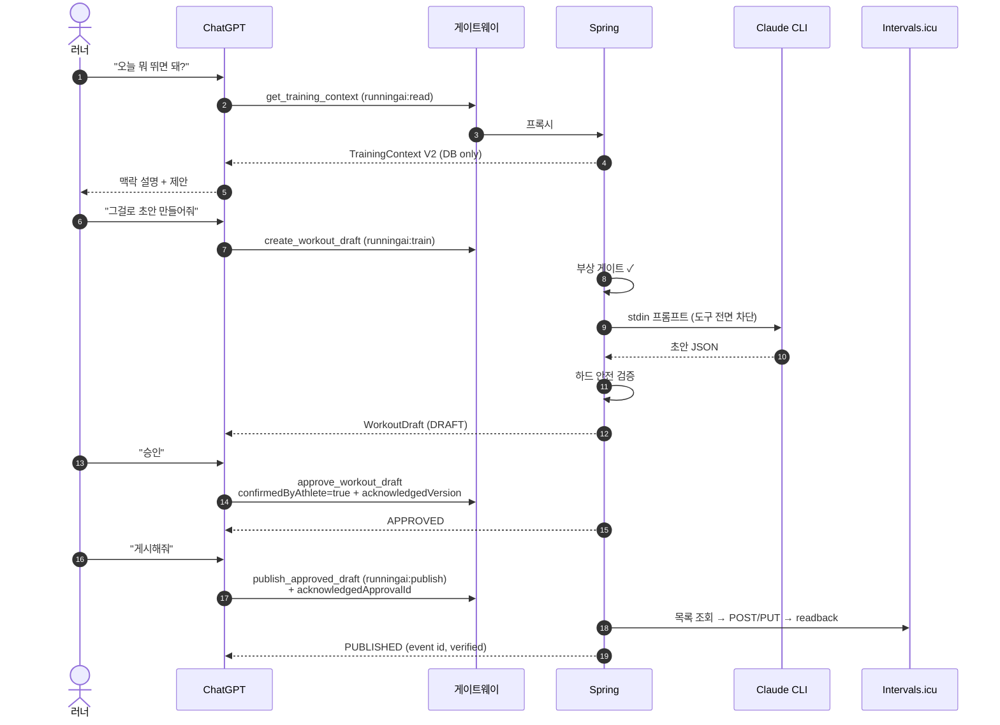

# 16. 사용자 시나리오와 실제 사용 예시

> 대상 독자: 🏃 일반 러너 (개발자용 호출 예시 병기)
>
> 아래 시나리오는 **현재 구현된 기능만**으로 구성했다. 🔵 표시가 붙은 것만 미래 설계다.

---

## 시나리오 1 — 평범한 화요일 아침 ✅

### 쉽게 말하면

> **07:10** 일어나서 ChatGPT에 "오늘 뭐 뛰면 돼?"라고 묻는다.
>
> ChatGPT가 내 어제 러닝(10km, 평균 심박 148), 오늘 HRV, 최근 2주 패턴을 읽고 답한다.
>
> *"어제 역치 구간에 14분 노출됐고 오늘 HRV가 평소보다 낮습니다. 이지런 45분을
> 5:45~6:00/km로 제안합니다."*
>
> **07:12** "좋아, 그걸로 해줘" → 초안이 만들어진다.
> **07:13** 초안을 읽어 보고 "승인" → 승인됨.
> **07:14** "시계에 보내줘" → Intervals.icu 캘린더에 올라간다.
> **07:30** 시계를 켜면 오늘 워크아웃이 떠 있다.

### 기술적으로는



**REST로 같은 일을 하면**:

```powershell
$d = Invoke-RestMethod -Method POST http://127.0.0.1:18080/api/v1/workout-drafts `
     -Body (@{date='2026-10-16'} | ConvertTo-Json) -ContentType 'application/json'
Invoke-RestMethod -Method POST "http://127.0.0.1:18080/api/v1/workout-drafts/$($d.id)/approve"
Invoke-RestMethod "http://127.0.0.1:18080/api/v1/workout-drafts/$($d.id)/publish-preview"
Invoke-RestMethod -Method POST "http://127.0.0.1:18080/api/v1/workout-drafts/$($d.id)/publish"
```

---

## 시나리오 2 — 무릎이 아프다 ✅

### 쉽게 말하면

> **월요일** 달리고 나니 무릎이 쑤신다. ChatGPT에 보고한다.
>
> 그 순간부터 **AI가 만들 수 있는 것은 휴식일뿐이다.** "가볍게라도 뛰자"고 설득해도
> 시스템이 거부한다.
>
> **목요일** 괜찮아져서 "다 나았다"고 보고한다.
> → 그때부터 **48시간 동안** 정상 훈련이 가능하다.
> → 48시간이 지나면 **다시 휴식만**. 괜찮으면 또 보고하면 된다.

### 왜 이렇게 설계했나

| 질문 | 답 |
| --- | --- |
| 시간이 지나면 저절로 낫는 걸로 치면 안 되나? | **안 된다.** 어떤 것도 시간 경과로 `RESOLVED`를 추론하지 않는다 |
| 보고를 안 하면? | **휴식만.** 보고 없음 = 알 수 없음 = 안전 측 |
| AI가 "괜찮아 보인다"고 판단할 수 있나? | **없다.** `RESOLVED`는 **데이터 허가이지 의학적 완치 판정이 아니다**. 프롬프트가 코치에게 이 문장을 명시한다 |
| 이전 부상 기록이 지워지나? | **아니다.** append-only. 코치는 과거 재발을 계속 본다 |
| 48시간은 왜? | `RUNNING_AI_INJURY_SAFETY_STALENESS_HOURS` 기본값. 조정 가능 |

```powershell
# 보고
Invoke-RestMethod -Method POST http://127.0.0.1:18080/api/v1/athlete/injury-reports `
  -Body (@{status='ACTIVE'; bodyPart='KNEE'; notes='우측 무릎 외측'} | ConvertTo-Json) `
  -ContentType 'application/json'

# 현재 게이트 판정
Invoke-RestMethod http://127.0.0.1:18080/api/v1/athlete/injury-state
```

> ⚠️ **셸 함정** (실제 사고): 보고 명령을 `||`로 체인하면 **파이프라인 전체가 재시도**되어
> **중복 행**이 생긴다. append-only 원장이므로 지울 수 없다. 게이트 판정에는 영향이 없다
> (`recorded_at DESC, id DESC` 타이브레이크).

---

## 시나리오 3 — 게시한 뒤에 마음이 바뀌었다 ✅

### 쉽게 말하면

> 아침에 "이지런 50분"을 게시했다. 점심에 일정이 바뀌어서 **35분**으로 줄이고 싶다.
>
> 이미 게시된 것을 **지우고 다시 만들지 않는다.** 대신 **수정(revision)** 을 제안하고,
> 내용을 승인하고, **따로** 적용을 인가한다.
>
> *"내용 승인"과 "실제로 캘린더를 바꿔도 된다는 허가"는 두 개의 결정이다.*

### 흐름

```
① POST /workout-drafts/{draftId}/published-revisions      제안 (PROPOSED)
② POST /published-workout-revisions/{id}/approve          내용 승인 (APPROVED)
③ GET  /published-workout-revisions/{id}/apply-preview    미리보기 (외부 쓰기 0)
④ POST /published-workout-revisions/{id}/apply            적용 (APPLIED)
```

### 중간에 누군가 Intervals에서 직접 고쳤다면

적용이 **쓰기 전에 거부**된다.

| 코드 | 뜻 |
| --- | --- |
| `REVISION_REMOTE_EVENT_MISSING` | 이벤트가 사라짐 |
| `REVISION_REMOTE_EVENT_DUPLICATE` | 같은 마커가 둘 이상 |
| `REVISION_REMOTE_EVENT_REPLACED` | 다른 이벤트로 교체됨 |
| `REVISION_REMOTE_EVENT_MODIFIED` | 외부에서 편집됨 |

**풀 수 없으면 `POST /{id}/abandon`** 으로 닫는다. 그러지 않으면 "게시물당 열린 수정 1건"
제약 때문에 **모든 후속 수정이 영구히 막힌다.**

> ✅ 실제 기록: Phase 10에서 수정 #1이 event 145043355에 `UPDATED`로 적용되었고 **FR265에서
> 확인**되었다.

---

## 시나리오 4 — 과거 데이터를 되살리다 ✅

### 쉽게 말하면

> 작년 여름 기록이 Garmin에 없다. Strava에는 있는데 API로는 못 가져온다.
>
> Strava에서 **전체 내보내기 ZIP**을 받아 풀고, 그 경로를 알려주면 RunningAI가
> **FIT 파일을 직접 읽어** 복원한다.
>
> 놀라운 점: Intervals.icu에 이미 있는 같은 운동과 **정확히 연결**된다. 추측이 아니라
> 파일 안의 `apple_health_uuid`가 Intervals의 id와 **문자 단위로 일치**하기 때문이다.

### 실측 결과

| 단계 | 결과 |
| --- | --- |
| Intervals 전용 임포트 | **25건** 신규 (샘플 46,880) |
| Strava 아카이브 임포트 | **15건** 신규 + **33건 보강** (랩 116, 샘플 18,541) |
| 미지원 종목 | 46건 기록 (근사하지 않고 제외) |
| 모호 / 실패 | **0 / 0** |
| 재실행 | **Δ=0** (17개 테이블) |
| 강제 종료 후 재개 | **무손실** |

```powershell
# Intervals 전용
Invoke-RestMethod -Method POST http://127.0.0.1:18080/api/v1/intervals/activity-import `
  -Body (@{oldest='2026-08-01'; newest='2026-09-13'} | ConvertTo-Json) -ContentType 'application/json'

# Strava 아카이브 (경로는 저장소 밖이어야 한다 — 실제 GPS가 들어 있다)
Invoke-RestMethod -Method POST http://127.0.0.1:18080/api/v1/strava/archive-import
```

> ⚠️ 두 임포터 모두 **게시 스위치나 Garmin 스케줄러가 켜져 있으면 기동을 거부**한다.
> **재-POST가 곧 재개이자 재시도**이며, 자동 재시도는 없다.

---

## 시나리오 5 — 어제 달리기를 분석하다 ✅

### 쉽게 말하면

> "어제 인터벌 어땠어?" 라고 물으면 이런 답이 돌아온다.
>
> *"5×1000m 세션입니다. 반복별 평균 페이스 4:02 / 4:00 / 4:03 / 4:05 / 3:58,
> 회복 구간 심박 강하는 각각 32 / 28 / 25 / 24 / 30 bpm,
> LTHR 이상 노출 14분 23초, 속도-심박 디커플링 +3.1%."*
>
> **"좋았다"나 "나빴다"는 말이 없다.** 그건 코치가 할 말이고, 분석 엔진은 **측정만** 한다.

### 무엇을 어떻게 재는가

| 지표 | 규칙 |
| --- | --- |
| 전후반 비교 | **경과 시간 중앙값**으로 쪼갠다 (샘플 개수 아님) |
| 존별 시간 | **존 합계** 기준 비율 |
| LTHR 노출 | **실제 샘플 간격을 적분** |
| 디커플링 | `(EF1-EF2)/EF1*100` — **RunningAI 자체 지표**, 임계값 없음 |
| 인터벌 그룹 | 랩의 `intensity_type` + `workout_step_index`를 **읽는다**. 페이스로 추론 **금지** |
| 결측 | **null. 추정하지 않는다** |

```powershell
Invoke-RestMethod -Method POST http://127.0.0.1:18080/api/v1/activities/123/analysis
Invoke-RestMethod http://127.0.0.1:18080/api/v1/training-analysis-report
```

> 📌 **"없는 지표"와 "낮은 지표"는 다르다.** Intervals에서 가져온 활동은 케이던스가
> **구조적으로 없고**(rpm↔spm 미변환 결정), Strava 랩은 인터벌 그룹이 **원리적으로
> 도출 불가**다. 코치에게 그 사실이 명시적으로 전달되어 **낮은 값으로 오독하지 못하게** 한다.

---

## 시나리오 6 — 시계만 보고 나간다 ✅

### 쉽게 말하면

> 폰을 안 보고 시계만 찬다. 워치페이스에 **`EASY 50M`** 이라고 떠 있다.
>
> 이 한 줄은 릴레이가 Spring의 승인된 계획을 읽어 만든 것이다. 아직 Intervals에 게시하지
> 않았어도 **승인만 했으면 보인다.** 휴식일이면 `REST`라고 **명시적으로** 뜬다 —
> "아무것도 없음"과 **다르다.**

| 시계에 뜨는 것 | 의미 |
| --- | --- |
| `EASY 50M` | 승인된 계획 있음 |
| `REST` | **휴식 결정** (결정이지 부재가 아니다) |
| (폴백) | 승인된 계획이 없어 Intervals나 레거시 파일을 봄 |

> 🎨 코치가 쓴 제목은 **절대 시계로 넘어가지 않는다.** 14글자 디스플레이에 모델 생성
> 자유 텍스트를 보내지 않기 위해, 계약에서 `title`을 **제외**했다. 릴레이가 타입과 시간으로
> 라벨을 **직접 만든다.**

---

## 시나리오 7 — 운영자의 아침 점검 ✅

```powershell
# 1) 구성요소 상태
.\scripts\windows\status-running-ai.ps1

# 2) 모든 소스의 신선도 (DB만, 네트워크 0회)
Invoke-RestMethod http://127.0.0.1:18080/api/v1/data-freshness

# 3) 동기화 시도 이력
Invoke-RestMethod http://127.0.0.1:18080/api/v1/garmin/sync/status
```

| 보이는 것 | 해석 |
| --- | --- |
| `collectionTracked: false` | 수동 임포터 — 오래된 데이터가 "새 게 없다"는 뜻이 **아니다** |
| `CONFIRMED_NO_DATA` | 원본에 정말 없었다 |
| `COLLECTION_FAILED` | 수집이 실패했다 |
| `NOT_COLLECTED` | 아직 실행한 적 없다 |
| `sync/status`의 `allowed` | **서킷 브레이커의 답**이지 스케줄러가 켜졌다는 뜻이 아니다 |

---

## 시나리오 8 🔵 `DESIGN` — 대회를 준비한다

> ⚠️ **미구현.** [10장](10-training-plan-and-goals.md)의 Phase 11 제안.

> **12주 뒤 하프마라톤, 목표 1:45.** 목표를 등록하면 코치가 매일의 판단에 그 맥락을 쓴다.
>
> *"D-84, 하프 목표 1:45. 현재 CTL 42. 오늘은 베이스 구간이므로 이지런 60분."*
>
> 계획은 **의도**를 말하고, **그날 할 운동은 여전히 그날의 데이터로 코치가 정한다.**
> 계획을 벗어난 날은 **실패가 아니라 사실로 기록**된다.

---

## 시나리오 9 — 무엇이 안 되는지 알고 쓰기

| 기대 | 실제 |
| --- | --- |
| "시계에 바로 보내줘" | RunningAI는 **Intervals까지만** 쓴다. Garmin 푸시는 Intervals 자체 연동 |
| "시계에 떴는지 확인해줘" | **불가.** `deviceDelivery`는 영구 `UNKNOWN` |
| "실패하면 다시 시도해줘" | **안 한다.** 미지 상태의 POST를 반복하지 않는 것이 설계 |
| "어제 못 한 운동을 오늘로 옮겨줘" | **없다** (놓친 실행 보정 미구현) |
| "알림 보내줘" | **없다** |
| "파워로 타깃 잡아줘" | 표현은 되지만 **게시에서 거부**. 검증된 Intervals 러닝 파워 문법이 없다 |
| "심박 150-160 bpm으로" | **게시 불가.** 렌더러는 %LTHR만 안다 |
| "AI가 알아서 매일 올려줘" | **설계상 영원히 불가.** 사람 승인이 모든 외부 쓰기 앞에 있다 |
| "1년치 추세 보여줘" | 보유 데이터가 **약 4.5개월**. 그 이전은 어떤 경로로도 도달 불가 |
