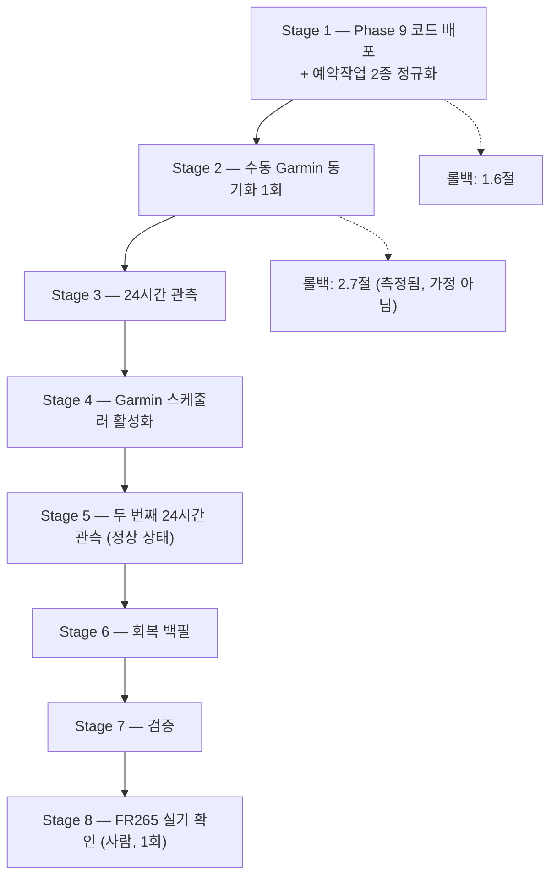
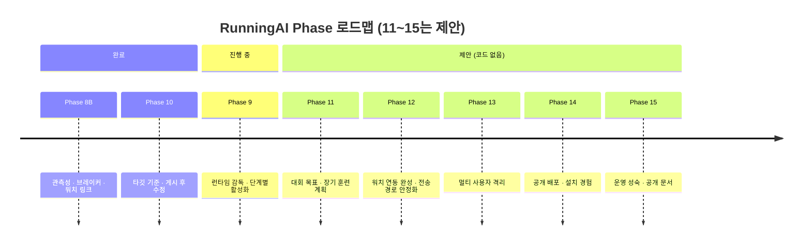

# 17. Phase 9 ~ 15 로드맵 정의

> ⚠️ **먼저 사실**: 저장소에 **Phase 11~15라는 이름의 계획 문서·코드·마이그레이션은
> 존재하지 않는다**(`docs/` 257개 문서 전수 grep, 일치 0건). Phase 9와 10은 실재하고,
> **11~15는 본 문서가 제안하는 설계안**이다.

---

## 1. 실제 Phase 연혁 (요약)

| Phase | 주제 | 결과 |
| --- | --- | --- |
| 1–4 | Spring 부트스트랩, Activity, PostgreSQL/Flyway, Garmin 수집·증분 동기화 | ✅ |
| 5C | StructuredWorkout → Intervals 렌더러 → 게시자 → 라이브 검증 → **FR265 DEVICE_VERIFIED** → 레거시 은퇴 | ✅ |
| 6A–6C | 게시 운영 트리거, 게시 스케줄러, MCP 어댑터 | ✅ (전부 OFF 기본) |
| 6E–6H | Claude 코치, 회복, 초안 승인·게시 게이트웨이, 상세 수집, 분석 엔진, Intervals 보강, 90일 백필, TrainingContext V2 | ✅ |
| 7B–7F | 부상 게이트, 데이터 신선도, 실데이터 이행, Intervals/Strava 임포터, 운영 전환, 훈련 MCP + 실제 게시 | ✅ |
| 8A | 수집 관측성 (V27/V28) | ✅ 운영 반영 |
| 8B | 서킷 브레이커, 게시 원장, 워치 링크, 도달 확인, 지표 결측 명시, 훈련 분석 리포트 (V29/V30) | ✅ 운영 반영 |
| **9** | **런타임 감독 + 운영 활성화 (진행 중)** | 🟡 |
| **10** | **타깃 기준 + 게시 후 수정 (V31)** | ✅ **완료, 운영 반영** |

---

## 2. Phase 9 — 런타임 감독과 단계별 운영 활성화 🟡 진행 중

### 2.1 코드 측 (완료)

| 항목 | 상태 |
| --- | --- |
| 워치독 3범주 확장 (핵심 / 독립 / 관측 전용) | ✅ |
| MCP 게이트웨이 감시 편입 (PID 없이 소켓+마커 식별) | ✅ |
| 터널 관측 전용 분류 (**절대 재시작 안 함**) | ✅ |
| 예약작업 **백데이트 2차 트리거** | ✅ |
| 부상 원장 정렬 타이브레이크 (`recorded_at DESC, id DESC`) | ✅ |
| Quick Tunnel 운영자 런처 (호스트명·필요 Worker 재배포 출력, **수행하지는 않음**) | ✅ |
| Stage 4 Route A — 스케줄러 스위치 플레이스홀더화 + 회귀 테스트 7종 | ✅ (**미배포**) |

### 2.2 운영 활성화 단계 (Runbook)

`docs/work-orders/2026-10-15-phase-9-production-runbook.md`가 단계별 절차를 정의한다.
**모든 단계가 개별 승인을 요구한다.**

| 단계 | 상태 (2026-10-16) |
| --- | --- |
| Stage 1 | ✅ PASSED |
| Stage 2 | ✅ PASSED (SUCCESS 동기화 1행) |
| Stage 3 | 🟡 관측 창 진행 |
| **Stage 4** | 🟡 **코드 완료(Route A), 운영 미활성.** 스케줄러는 여전히 OFF |
| Stage 5–8 | ⏳ 두 개의 실제 24시간 창에 게이트됨 |

### 2.3 Stage 4가 왜 신중한가

| 사실 | 내용 |
| --- | --- |
| 공백 | Garmin 자동 동기화가 꺼져 있어 **신규 활동이 자동으로 들어오지 않는다** |
| 비용 | 한 틱 = **Garmin 요청 정확히 1회** |
| 보호 | 서킷 브레이커(AUTH 3 / RATE_LIMIT 1 / TRANSIENT 8) + **15분 하드 플로어** |
| 충돌 | **백필·임포터는 스케줄러가 켜져 있으면 기동을 거부**한다 → 과거 데이터 작업과 동시에 켜지 말 것 |
| 함정 | `sync/status`의 `allowed`는 **브레이커의 답**이지 스케줄러 상태가 아니다 |

---

## 3. Phase 10 — 타깃 기준과 게시 후 수정 ✅ 완료

| 구성 | 내용 |
| --- | --- |
| **(A) `TargetBasis`** | `HEART_RATE` / `PACE` / `POWER` 세션별 **요청**. `null` = 이전과 완전 동일 |
| **(B) `published_workout_revision`** (V31) | 게시 후 수정의 독립 생명주기 |
| 감사에서 고친 2건 | 게이트웨이 **deny-by-default**, 충돌 수정의 **영구 교착 해소(`abandon`)** |
| 실증 | 수정 #1 → event 145043355 `UPDATED` → **FR265 확인** |
| 게이트웨이 | **19개 도구** 서빙 |

> 📌 **"대부분 이미 존재했고 일부러 다시 만들지 않았다"** — 페이스 타깃, `M:SS/km Pace` 문법,
> 구간별 `PrimaryTargetType`, 게시자의 in-place UPDATE·소유권 마커·readback·"re-list, never
> re-POST"는 **전부 기존 자산을 재사용**했다. 이 Phase는 **HTTP 코드를 한 줄도 추가하지 않았다.**

---

## 4. 🔵 제안 — Phase 11 ~ 15

### 4.1 도출 근거

저장소의 **기능 완성 감사 보고서**(2026-10-15)가 식별한 공백 P1~P4 중,
P1/P2/P3-1~2는 Phase 8B·9·10이 소화했다. **남은 것과 사용자가 요청한 최종 기능**을 다섯
Phase로 묶었다.

### 4.2 Phase 11 🔵 — 대회 목표와 장기 훈련 계획

| 항목 | 내용 |
| --- | --- |
| 목적 | 오늘 하루(D일) 시야를 **시즌 시야**로 확장 |
| 신규 테이블 | `race_goal` / `training_plan` / `training_plan_week` / `training_plan_day_intent` (V32~) |
| 핵심 결정 | **계획은 입력이지 명령이 아니다.** 그날의 워크아웃은 여전히 당일 데이터로 코치가 정한다 |
| 선행 조건 | 레이스 페이스 모델(⛔), 결정론 QUALITY 구조(⛔), 데이터 신선도(Phase 9 Stage 4) |
| 최소 버전 | **`race_goal` 1테이블 + 컨텍스트 한 줄** — 가장 낮은 비용으로 가장 큰 체감 변화 |
| 하지 않을 것 | 자동 게시, 준수율 "점수", 인구 규준 기반 목표 추정 |
| 상세 | [10장](10-training-plan-and-goals.md) |

### 4.3 Phase 12 🔵 — 워치 연동 완성

| 항목 | 내용 |
| --- | --- |
| 공백 1 | **Quick Tunnel 호스트명이 재부팅마다 소멸** |
| 해결 | **Cloudflare Named Tunnel** (무료, 고정 호스트명) 또는 재부팅 절차 문서화 |
| 공백 2 | 워치페이스 소스(`C:\running-ai-watchface`)가 **버전 관리 밖** |
| 해결 | **복사 편입만** 검토 (레거시 변경 금지 제약 준수). 우선순위 최하 |
| 공백 3 | 도달 확인이 Intervals까지만 |
| 현실 | `deviceDelivery`는 **영구 UNKNOWN** — 이것은 공백이 아니라 **사실** |
| 상세 | [11장](11-watch-integration.md) |

### 4.4 Phase 13 🔵 — 멀티 사용자 격리

| 항목 | 내용 |
| --- | --- |
| 권고 모델 | **모델 A — 프로세스별 완전 격리** (= 각자 설치) |
| 데이터 모델 변경 | **불필요** — 모든 테이블이 이미 `athlete_id` 보유 |
| 코드 변경 | **거의 없음** — `getDefaultAthlete()`가 "프로세스당 선수 1명"으로 정확히 맞는 의미가 됨 |
| OAuth | **게이트웨이 코드 무변경** — `ALLOWED_SUB` 단일 주체 제약이 그대로 격리 수단 |
| 권고하지 않음 | 공유 스키마 + 행 필터(모델 C) — 유출 위험 최대, H2/PostgreSQL RLS 충돌 |
| 상세 | [14장](14-multi-user-isolation.md) |

### 4.5 Phase 14 🔵 — 공개 배포와 설치 경험

| 항목 | 내용 |
| --- | --- |
| 3티어 | T1 읽기 전용 체험 / T2 개인 전체 / T3 ChatGPT·워치 연동 |
| 산출물 | compose 프로파일, 컨테이너 이미지 2종, GitHub Release, `SECURITY.md`, 문서 사이트 |
| 원칙 | **fail closed**, 기본 전부 OFF, 비밀은 생성하되 출력하지 않음, 레거시 경로 의존 제거 |
| 하지 않을 것 | **호스팅형 SaaS** — 데이터가 PC를 떠나지 않는 것이 제품 정체성 |
| 상세 | [13장](13-distribution-and-install.md) |

### 4.6 Phase 15 🔵 — 운영 성숙과 공개 문서

| 항목 | 내용 |
| --- | --- |
| 백업·복구 | 현재 운영 롤백 자산은 V30용 SQL 2개. **정기 백업 자동화와 복원 리허설**이 공백 |
| 관측성 | 메트릭 노출(현재는 상태 엔드포인트 + 상태 파일), 로그 보존 정책 |
| 보안 | 의존성 스캔, `SECURITY.md`, 비밀 스캔 CI 게이트 |
| 문서 | **본 명세서 기반 공개 문서 사이트** |
| 선행 | Phase 13·14 |

---

## 5. 우선순위 권고

저장소 감사 보고서의 원칙 **"이미 구현된 것은 다시 만들지 않는다"** 를 유지한 순서:

| 순위 | 항목 | 비용 | 위험 |
| --- | --- | --- | --- |
| 1 | **Phase 9 Stage 4~8 완주** (데이터 신선도) | 0 (설정) | 낮음 |
| 2 | **회복 백필** (28일 창 충족) | 0 (기존 엔드포인트) | 낮음 |
| 3 | **Phase 11 최소 버전** (`race_goal` 1테이블) | 소 | 낮음 |
| 4 | **Phase 12-a** (Named Tunnel) | 0 (무료) | 낮음 |
| 5 | Phase 14 T1/T2 (설치 자동화) | 중 | 중 |
| 6 | Phase 13 모델 A | 소~중 | 중 |
| 7 | Phase 11 전체 (주기화) | 대 | 중 |
| 8 | Phase 15 | 중 | 낮음 |

---

## 6. 하지 않을 것 (중복 개발 방지 — 감사 보고서 명시)

> 드래프트 생성/수정/승인 API, Intervals 렌더러·게시자·readback, 부상 게이트, 분석 엔진,
> TrainingContext V2, 임포터 3종, 백필, 워치독, MCP read/train 도구, OAuth 경로 —
> **전부 구현 완료.** 훈련부하 계산식 교체(P3-4)도 **하지 않는다.**

추가로 본 문서가 **영구 비목표**로 확인하는 것:

| 비목표 | 사유 |
| --- | --- |
| Garmin 쓰기 경로 | 설계상 영구 부재. AST 테스트가 빌드로 강제 |
| 자동 게시 (사람 승인 없이) | 제품 핵심 가치 |
| 게시 자동 재시도 | 미지 상태의 POST를 반복하지 않는다 |
| 분석 엔진의 판정·점수 | 측정/판단 분리. 테스트가 빌드로 강제 |
| Strava API 클라이언트 | 로컬 아카이브만 |
| 시계 도달 "추정" | `UNKNOWN`을 추측으로 바꾸지 않는다 |
